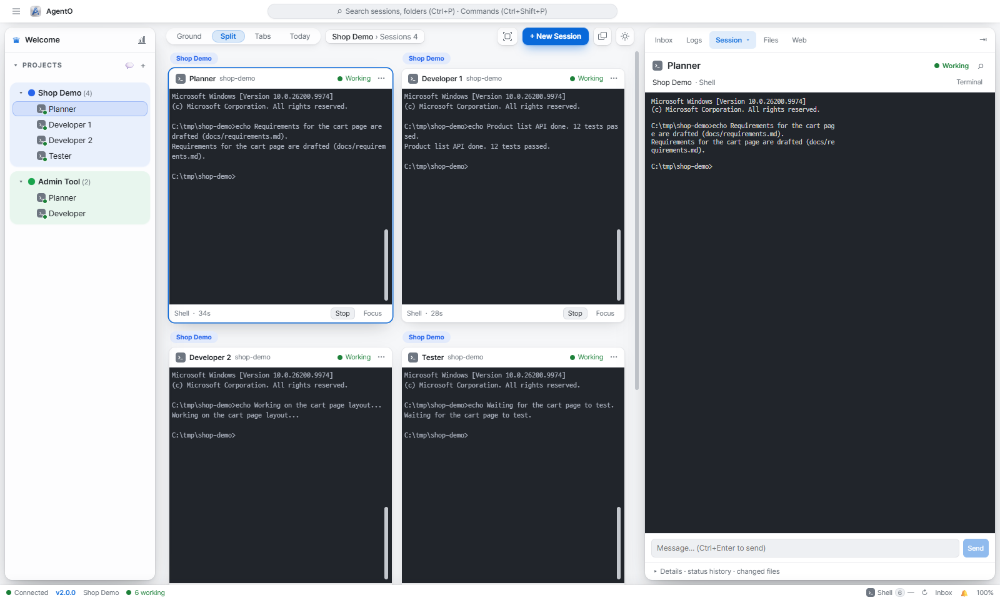
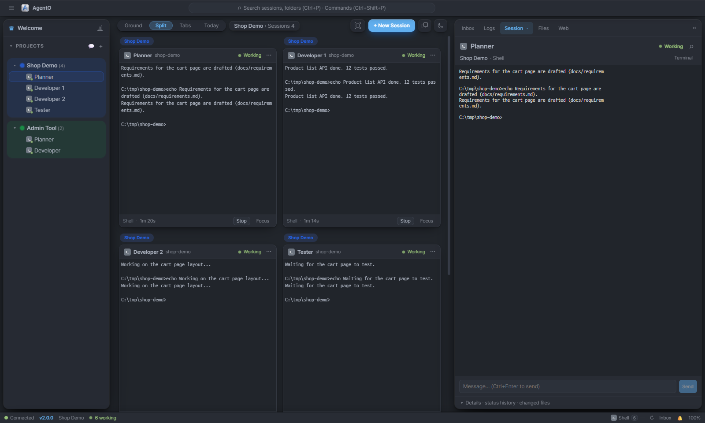
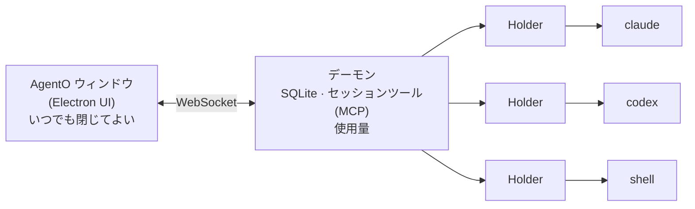
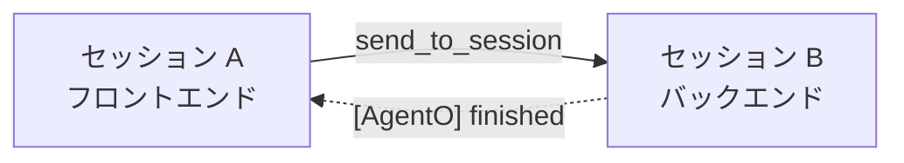

<p align="right"><a href="README.md">English</a> · <a href="README.ko.md">한국어</a> · <a href="README.zh.md">中文</a> · <b>日本語</b></p>

# AgentO

**AI コーディングセッションを一か所で。** AgentO は Claude Code、Codex、Gemini CLI、Ollama、通常のシェルを並べて実行し、セッションを動かし続け、セッション同士が助けを求め合えるようにするデスクトップアプリ(Windows · macOS)です。

> **基本の考え方:** ウィンドウを閉じてもセッションは動き続けます。バックグラウンドのデーモンがすべてのセッションを所有し、UI は接続・切断できるただの窓です。

## ダウンロード

最新のビルドは **[Releases](https://github.com/dongliquan/AgentO/releases/latest)** から入手してください。実行したい CLI(Claude Code、Codex など)は別途インストールしてサインインしておく必要があります。

| プラットフォーム | ファイル |
|---|---|
| Windows(インストーラー) | `AgentO-<version>-win-x64-setup.exe` |
| Windows(インストール不要) | `AgentO-<version>-win-x64-portable.exe` |
| macOS、Apple Silicon | `AgentO-<version>-mac-arm64.dmg` |
| macOS、Intel | `AgentO-<version>-mac-x64.dmg` |

**ビルドはまだコード署名されていないため、初回起動時に警告が表示されます。**

- **Windows:** SmartScreen が「Windows によって PC が保護されました」と表示します。**詳細情報 → 実行** をクリックするか、ダウンロードしたファイルを右クリック → プロパティ → **ブロックの解除** にチェックしてください(PowerShell: `Unblock-File <ファイル>`)。
- **macOS:** アプリを右クリックして **開く** を選び、もう一度 **開く** を押します。または `xattr -dr com.apple.quarantine /Applications/AgentO.app` を実行します。

ソースからビルドする場合は[クイックスタート](#クイックスタート)を参照してください。

## スクリーンショット

| Light | Dark |
|:-:|:-:|
|  |  |

<sub>デモプロジェクトの 4 つのセッションを Split ビューで表示(ここでは AI エージェントの代わりに通常のシェルセッション)。ライトとダークのテーマ。</sub>

## なぜ AgentO か

| AgentO なし | AgentO あり |
|---|---|
| エージェントごとにターミナルのタブが 1 つ、見失いやすい | すべてのセッションが 1 つのキャンバス(**Ground**)上のカード、またはタブ、または分割表示 |
| ターミナルを閉じるとセッションを失う | UI を閉じてもセッションは動き続け、開き直すとそのまま戻る |
| エージェント間のメッセージを手で中継 | セッションが同じプロジェクトの別のセッションに頼み、答えを受け取れる |
| 長い会話が気づかないうちにトークンを消費 | 会話サイズを表示し、**Fresh start** が要約付きで新しい会話に引き継ぐ |
| 再起動するとセッションがどこまで進んだか忘れてしまう | **Pick up where you left off** が停止中のセッションと、最後の依頼・終わった位置を一覧表示 |

セッションは各ツールの **CLI とご自身のサブスクリプションのログイン**で動かします。AgentO は API キーを要求しません。

## 仕組み



各セッションは専用の小さな **holder** プロセスで動くため、デーモンを再起動してもエージェントは止まりません。

## 頼み合うセッション

Claude Code と Codex のセッションは MCP でいくつかのツールを受け取ります。階層も管理者もなく、セッションが別のセッションにそのまま頼みます。



- `list_sessions` は同じプロジェクトの他のセッションを、`read_session` はそのセッションの作業内容を表示します。
- `send_to_session` で依頼を送ります。相手が終えると、最後の答えが `[AgentO] … finished` メッセージとタスク番号(`#T12`)付きで依頼元に戻ります。
- `report_up` は返答や聞き返しに、`update_memory` はすべてのセッションが起動時に受け取るプロジェクトメモリに 1 行追加するのに使います。

## 機能

| 領域 | 得られるもの |
|---|---|
| **Ground** | セッションカードのキャンバス、プロジェクト領域、ミニマップ、フォーカスモード |
| **ビュー** | Ground · Split · Tabs · Today(今あなたの判断が必要なこと) |
| **続きから** | 停止中のセッションの最後の依頼と終わった位置。再起動後に **Resume all** |
| **Chat** | カード上で Claude/Codex の会話を読める: ツール呼び出し、他のセッションからのメッセージ、画像、ファイルリンク、質問・権限カード |
| **右パネル** | Session · Files · Inbox · Web(Gemini、ChatGPT) |
| **プロジェクトメモリ** | プロジェクトごとに 1 ファイル(決定、ルール、地図)を Claude セッションの起動時に注入 |
| **Autopilot** | 不在の間もセッション 1 つが進め続ける: 「完了」の基準を書き出し、残りを片づけ、自分で止まる |
| **トークン管理** | 会話サイズのチップ、自動 Fresh start、モデル選択、使用量レポート |
| **要対応** | あなたの判断を待つ質問やプロンプトを 1 つの通知にまとめる。あなたを待っているセッションは決してスリープさせない |
| **保存 / インポート** | プロジェクトを `.agento` ファイルとして保存、既存の Claude Code セッションをインポート |
| **ファイル** | Markdown、JSON、CSV、画像のビューアを、それぞれ独立したウィンドウで |

## 対応エージェント

| Agent | Terminal | チャット表示 | 他のセッションに依頼 | Fresh start / 使用量レポート |
|---|:-:|:-:|:-:|:-:|
| Claude Code | ✅ | ✅ | ✅ | ✅ |
| Codex | ✅ | ✅ | ✅ | — |
| Gemini CLI | ✅ | — | — | — |
| Ollama | ✅ | — | — | — |
| Shell | ✅ | — | — | — |

Gemini CLI は個人プランのサポートを終了したため、ここではターミナルのみです。

## クイックスタート

**必要なもの:** Node.js 22(LTS)と、使いたい CLI(`claude`、`codex`、`gemini`、`ollama`。`PATH` から検索)。Windows ではネイティブモジュールのビルドに Visual Studio Build Tools と Python が必要です。

```bash
git clone https://github.com/dongliquan/AgentO.git
cd AgentO
npm install        # builds node-pty and better-sqlite3 for Electron
npm run dev        # starts the app
```

その後:

1. **Agents › Connections** を開き、Claude Code がインストール・サインイン済みか確認します。
2. *Projects* の横の **+** を押してプロジェクト(ディスク上のフォルダー)を作ります。
3. フォルダーの **+** を押してセッションを開始します。
4. ウィンドウを閉じ、トレイから開き直します。セッションは動き続けています。

| コマンド | 用途 |
|---|---|
| `npm run dev` | 開発モードで実行 |
| `npm run typecheck` | main と renderer の型チェック |
| `npm run smoke` | 使い捨てデーモンを起動して確認(AI 呼び出しなし) |
| `npm run dist:win` | Windows インストーラー + ポータブル exe → `dist/`(署名なし) |
| `npm run dist:mac` | macOS dmg + zip(Mac で実行) |

`v1.1.0` のようなタグを push すると、GitHub Actions が Windows と macOS のパッケージをビルドします。

## データの保存場所

| 項目 | 場所 |
|---|---|
| データフォルダー | `%APPDATA%\AgentO` (macOS: `~/Library/Application Support/AgentO`) |
| データベース、ログ | `asm.db`, `logs/` |
| プロジェクトメモリ、セッションツールの設定 | `team/` |
| 貼り付けた画像 | `attachments/` |

デーモンは `127.0.0.1` のみで待ち受け、すべての接続にデータフォルダーに保存されたランダムなトークンが必要です。

## キーボードショートカット

| キー | 操作 |
|---|---|
| Ctrl+N | 新しいセッション |
| Ctrl+P · Ctrl+Shift+P | クイックオープン · コマンドパレット |
| Ctrl+1 … 4 | Ground · Split · Tabs · Today |
| Ctrl+F | 検索 |
| Ctrl+B | サイドバーの切り替え |
| Ctrl+Shift+B | パネルを別ウィンドウに |
| Ctrl+Shift+W | 入力待ちのセッションへ移動 |
| F2 · F11 | 名前変更 · フォーカス表示 |

## 設定(環境変数)

| 変数 | 意味 |
|---|---|
| `AGENTO_DATA_DIR` | 別のデータフォルダーを使う |
| `ASM_PORT` | デーモンのポート(既定 47831) |
| `ASM_HIBERNATE_MIN` | アイドルのセッションがスリープするまでの分数(既定 30) |
| `AGENTO_PLAYER_MODEL` | モデル未選択時の Claude の既定モデル(既定 Opus 5.5) |
| `AGENTO_AUTO_FRESH=0` | 自動 Fresh start をオフにする |

## プロジェクト構成

| フォルダー | 内容 |
|---|---|
| `src/daemon/` | バックグラウンドデーモン: WebSocket + MCP サーバー、SQLite、使用量。`holder.ts` が 1 つのセッションを所有 |
| `src/main/` | Electron main: ウィンドウ、メニュー、トレイ、デーモン起動、ディープリンク |
| `src/preload/` | main と UI の間の安全なブリッジ |
| `src/renderer/` | React + zustand + xterm の UI |
| `src/shared/` | メッセージプロトコルと共有ヘルパー |
| `tests/smoke/` | デーモンと UI のスモークテスト |
| `docs/` | 設計メモ |

## 既知の制限

- ビルドはまだコード署名されていません。Windows SmartScreen が警告し、macOS は手動で開く必要があります。
- 使用量はローカルの会話ログから算出しており、サブスクリプションの残り枠は見えません。
- 自動更新や「A が終わったら B を実行」といった連鎖はまだありません。
- セッション同士の依頼は主に Claude Code で試しており、Codex での検証は少なめです。

## セキュリティ

Windows、macOS、接続する CLI は、あなたのファイルを操作できるものとして信頼されます。エージェントはあなたが与えた権限で動きます: 権限の確認を見直し、*このフォルダーを信頼* は管理しているフォルダーにのみ使ってください。脆弱性は公開 Issue ではなく、GitHub の *Report a vulnerability* ボタンから非公開で報告してください。

## ライセンス

[MIT](LICENSE) © dongliquan
