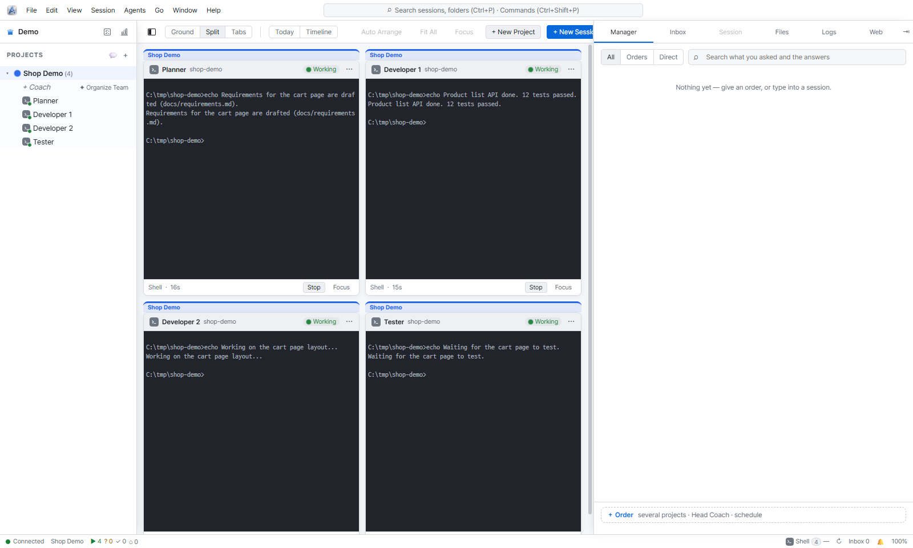
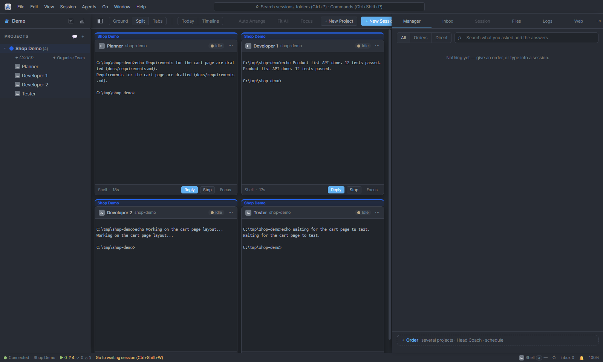
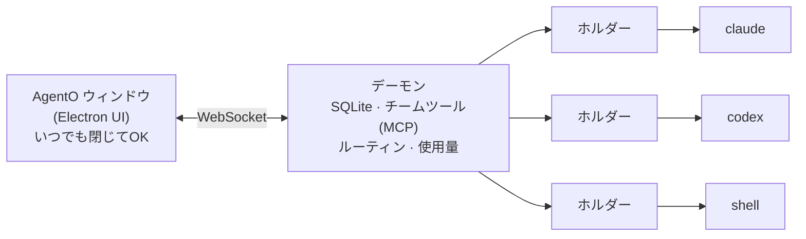
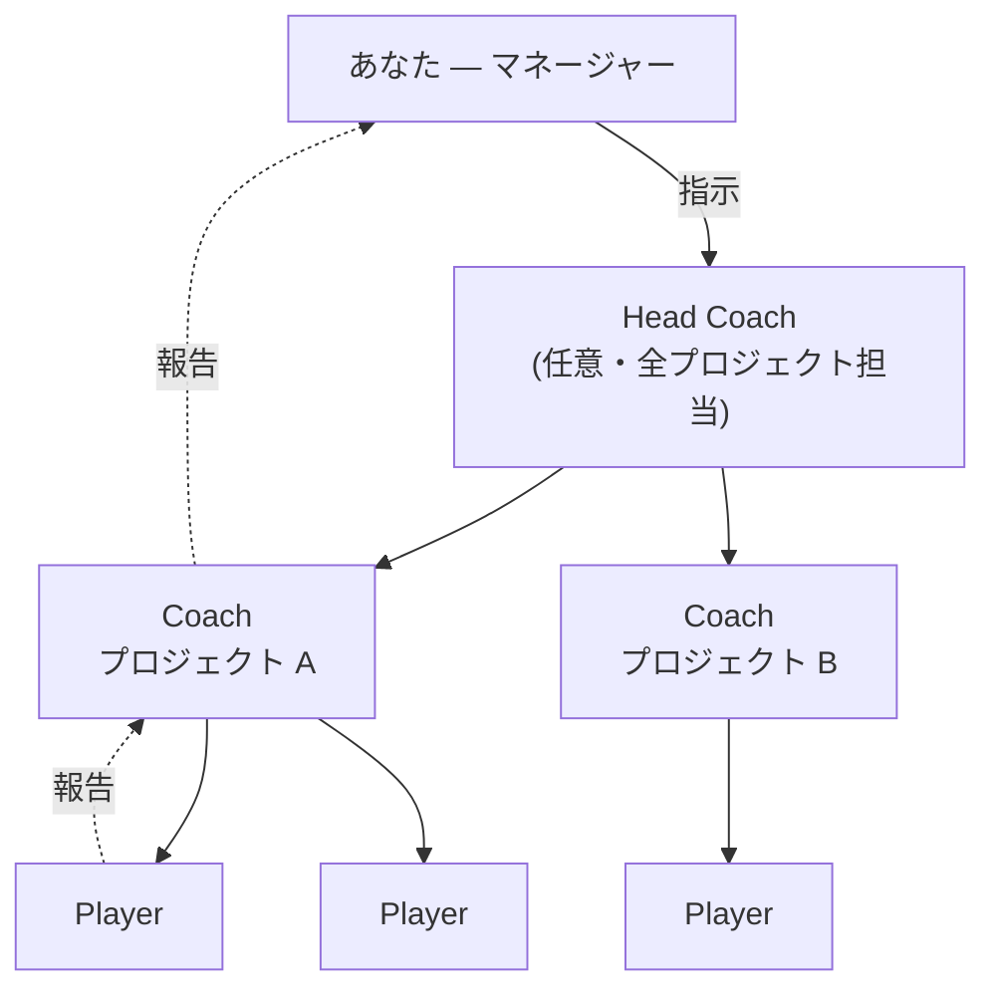

<p align="right"><a href="README.md">English</a> · <a href="README.ko.md">한국어</a> · <a href="README.zh.md">中文</a> · <b>日本語</b></p>

# AgentO

**すべての AI コーディングエージェントを、ひとつのボードで。** AgentO は、Claude Code・Codex・Gemini CLI・Ollama・通常のシェルを並べて実行し、小さなチームのように管理できるデスクトップアプリ（Windows · macOS）です。

> **基本の考え方:** ウィンドウを閉じてもセッションは動き続けます。セッションはバックグラウンドのデーモンが保持し、UI はいつでも接続・切断できる画面にすぎません。

## スクリーンショット

| ライト | ダーク |
|:-:|:-:|
|  |  |

<sub>デモプロジェクトの 4 セッションを Split ビューで表示（ここでは AI エージェントの代わりに通常のシェルを使用）。ライト／ダークテーマ。</sub>

## なぜ AgentO か

| AgentO なし | AgentO あり |
|---|---|
| エージェントごとにターミナルのタブ、どれが何か見失いがち | すべてのセッションが 1 つのキャンバス（**Ground**）上のカードに |
| ターミナルを閉じるとセッションも消える | UI を閉じてもセッションは作業を続け、開き直せばそのまま復元 |
| エージェント間の連絡を人が手で中継 | エージェント同士が指示・報告をやり取りし、あなたは指示を出すだけ |
| 長い会話が知らないうちにトークンを消費 | 会話サイズを表示。**Fresh start** で要約を引き継いで新しい会話へ |
| 何が終わったかの記録がない | タイムライン、日次レポート、タスク番号（`#T12`） |

セッションは各ツールの **CLI とご自身のサブスクリプションのログイン**だけで動きます。AgentO は API キーを求めません。

## 仕組み



各セッションは小さな**ホルダー**プロセスが 1 つずつ保持するため、デーモンを再起動してもエージェントは止まりません。

## チームモデル

あなたは**マネージャー（Manager）**です。指示を出すと、セッションが仕事を分担して報告します。



| 役割 | すること |
|---|---|
| **マネージャー**（あなた） | 指示を出し、質問に答え、判断する |
| **Head Coach** | 任意。指示を適切なプロジェクトへ振り分ける |
| **Coach** | プロジェクトごとに 1 つ。仕事を分けて Player に渡し、結果をまとめる |
| **Player** | 実際のコーディング担当。Coach はファイルを直接編集しない |
| **Reviewer** | 完了した仕事をクロスチェックする Codex セッション（新規プロジェクトごとに追加） |

指示にはタスク番号（`#T12`）が付き、報告まで一貫して追跡されるので、何が終わり何が待っているか一目で分かります。

## 機能

| 領域 | 内容 |
|---|---|
| **Ground** | セッションカードのキャンバス、プロジェクト/パートの領域、流れる指示・報告ライン、ミニマップ、フォーカス表示 |
| **ビュー** | Ground · Split · Tabs · Timeline（完了した機能）· Today（今あなたが必要なこと） |
| **会話** | Claude/Codex の会話をカード上で表示：ツール呼び出し、チームメッセージ、画像、ファイルリンク、質問・権限カード |
| **右パネル** | Session · Files · Manager · Inbox · Logs · Web（Gemini、ChatGPT） |
| **プロジェクトメモリ** | プロジェクトごとに決定・ルール・地図を 1 ファイルにまとめ、Claude セッション開始時に注入 |
| **ルーティン** | 定期的な指示（N 分ごと、毎日 HH:MM）。UI を閉じていても実行 |
| **トークン管理** | 会話サイズのチップ、自動 Fresh start、モデル選択、使用量レポート |
| **Needs you** | あなたの判断待ちの質問やプロンプトを 1 つの通知に集約 |
| **保存・取り込み** | プロジェクトを `.agento` ファイルとして保存・開く、既存の Claude Code セッションを取り込み |
| **ファイル** | Markdown · JSON · CSV · 画像ビューア（ファイルごとに別ウィンドウ） |

## 対応エージェント

| エージェント | ターミナル | 会話ビュー | チームメンバー | Fresh start / 使用量レポート |
|---|:-:|:-:|:-:|:-:|
| Claude Code | ✅ | ✅ | ✅ | ✅ |
| Codex | ✅ | ✅ | ✅ | — |
| Gemini CLI | ✅ | — | — | — |
| Ollama | ✅ | — | — | — |
| シェル | ✅ | — | — | — |

Gemini CLI は個人プランのサポートが終了したため、ここではターミナル表示のみです。

## クイックスタート

**必要なもの:** Node.js 22（LTS）、使いたい CLI（`claude`、`codex`、`gemini`、`ollama`。`PATH` から自動検出）。Windows ではネイティブモジュールのビルドに Visual Studio Build Tools と Python が必要です。

```bash
git clone https://github.com/dongliquan/AgentO.git
cd AgentO
npm install        # Electron 用に node-pty と better-sqlite3 をビルド
npm run dev        # アプリを起動
```

その後：

1. **Agents › Connections** を開き、Claude Code がインストール・ログイン済みか確認します。
2. *Projects* の横の **+** でプロジェクト（ディスク上のフォルダ）を作成します。
3. フォルダの **+** でセッションを開始するか、**Manager** から指示を送ります。
4. ウィンドウを閉じ、トレイから開き直します。セッションは動き続けています。

| コマンド | 用途 |
|---|---|
| `npm run dev` | 開発モードで実行 |
| `npm run typecheck` | メインとレンダラーの型チェック |
| `npm run smoke` | 使い捨てデーモンで動作確認（AI 呼び出しなし） |
| `npm run dist:win` | Windows インストーラー + ポータブル exe → `dist/`（未署名） |
| `npm run dist:mac` | macOS の dmg + zip（Mac で実行） |

`v1.0.0` のようなタグを push すると、GitHub Actions が Windows と macOS のパッケージをビルドします。

## データの場所

| 項目 | 場所 |
|---|---|
| データフォルダ | `%APPDATA%\AgentO`（macOS: `~/Library/Application Support/AgentO`） |
| データベース・ログ | `asm.db`、`logs/` |
| プロジェクトメモリ・チームフォルダ | `team/` |
| 貼り付けた画像 | `attachments/` |

デーモンは `127.0.0.1` のみで待ち受け、すべての接続にデータフォルダ内のランダムなトークンが必要です。

## ショートカット

| キー | 操作 |
|---|---|
| Ctrl+N | 新しいセッション |
| Ctrl+P · Ctrl+Shift+P | クイックオープン · コマンドパレット |
| Ctrl+1 … 5 | Ground · Split · Tabs · Timeline · Today |
| Ctrl+F | 検索 |
| Ctrl+B | サイドバーの切り替え |
| Ctrl+Shift+B | パネルを別ウィンドウに |
| Ctrl+Shift+W | 入力待ちのセッションへ移動 |
| F2 · F11 | 名前変更 · フォーカス表示 |

## 設定（環境変数）

| 変数 | 意味 |
|---|---|
| `AGENTO_DATA_DIR` | 別のデータフォルダを使用 |
| `ASM_PORT` | デーモンのポート（既定 47831） |
| `ASM_HIBERNATE_MIN` | 待機中のセッションが休止するまでの分数（既定 30） |
| `AGENTO_HEADLESS=0` | チームセッションを headless ではなくターミナルで開始 |
| `AGENTO_PLAYER_MODEL` · `AGENTO_COACH_MODEL` | Player / Coach の既定モデル |
| `AGENTO_AUTO_FRESH=0` | 自動 Fresh start をオフ |

## フォルダ構成

| フォルダ | 内容 |
|---|---|
| `src/daemon/` | バックグラウンドデーモン：WebSocket + MCP サーバー、SQLite、チーム、ルーティン、使用量。`holder.ts` が 1 セッションを保持 |
| `src/main/` | Electron メイン：ウィンドウ、メニュー、トレイ、デーモン起動、ディープリンク |
| `src/preload/` | メインと UI の間の安全なブリッジ |
| `src/renderer/` | React + zustand + xterm の UI |
| `src/shared/` | メッセージ規約と共通コード |
| `tests/smoke/` | デーモン・UI のスモークテスト |
| `docs/` | 設計ドキュメント |

## 既知の制限

- ビルドはまだコード署名されていません。Windows では SmartScreen の警告が出て、macOS では手動で開く必要があります。
- 使用量はローカルの会話ログに基づきます。サブスクリプションの残り枠は分かりません。
- 自動アップデートと「A が終わったら B を開始」するチェーンはまだありません。
- チーム機能は主に Claude Code で試しており、Codex・Gemini を Coach にする構成の検証は不十分です。

## セキュリティ

AgentO と接続した CLI は、あなたのファイルを操作できます。エージェントは与えた権限で動くため、権限の確認をよく読み、*Trust this folder* は自分で管理しているフォルダにだけ使ってください。脆弱性は公開 Issue ではなく、GitHub の *Report a vulnerability* から非公開で報告してください。

## ライセンス

[MIT](LICENSE) © dongliquan
