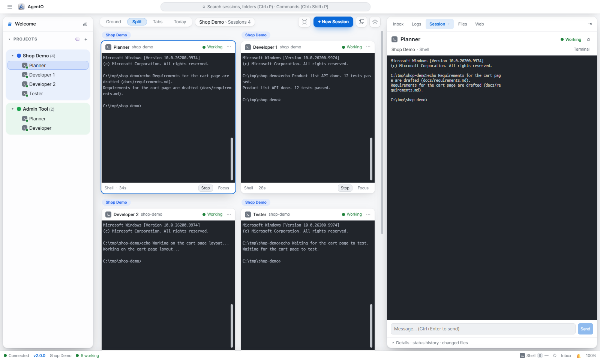
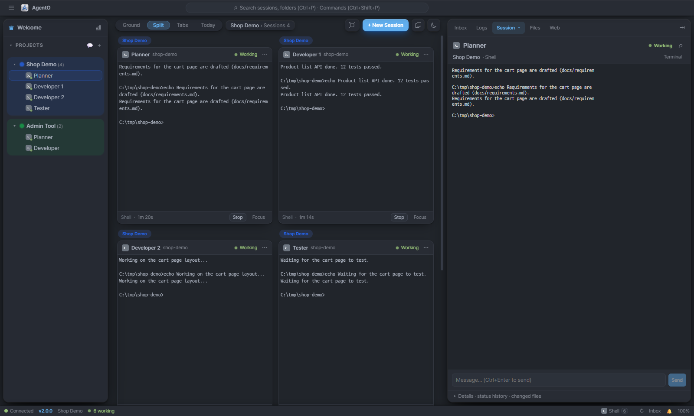
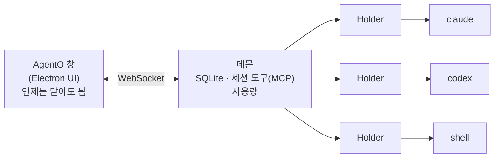
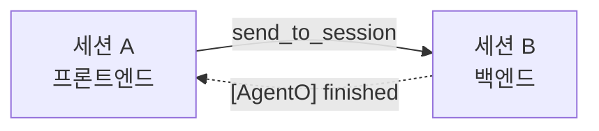

<p align="right"><a href="README.md">English</a> · <b>한국어</b> · <a href="README.zh.md">中文</a> · <a href="README.ja.md">日本語</a></p>

# AgentO

**AI 코딩 세션을 한곳에서.** AgentO 는 Claude Code, Codex, Gemini CLI, Ollama, 일반 셸을 나란히 실행하고, 세션을 계속 살려 두며, 세션끼리 서로 도움을 요청하게 해 주는 데스크톱 앱(Windows · macOS)입니다.

> **핵심 아이디어:** 창을 닫아도 세션은 계속 실행됩니다. 백그라운드 데몬이 모든 세션을 소유하고, UI 는 붙었다 떨어지는 창일 뿐입니다.

## 다운로드

**[Releases](https://github.com/dongliquan/AgentO/releases/latest)** 에서 최신 빌드를 받으세요. 실행하려는 CLI(Claude Code, Codex 등)는 따로 설치하고 로그인해 두어야 합니다.

| 플랫폼 | 파일 |
|---|---|
| Windows (설치 파일) | `AgentO-<version>-win-x64-setup.exe` |
| Windows (설치 없이) | `AgentO-<version>-win-x64-portable.exe` |
| macOS, Apple Silicon | `AgentO-<version>-mac-arm64.dmg` |
| macOS, Intel | `AgentO-<version>-mac-x64.dmg` |

**빌드에 아직 코드 서명이 없어서 처음 실행할 때 경고가 뜹니다.**

- **Windows:** SmartScreen 이 "Windows의 PC 보호"라고 표시합니다. **추가 정보 → 실행** 을 누르거나, 받은 파일을 우클릭 → 속성 → **차단 해제** 를 체크하세요(PowerShell: `Unblock-File <파일>`).
- **macOS:** 앱을 우클릭하고 **열기** 를 두 번 선택하세요. 또는 `xattr -dr com.apple.quarantine /Applications/AgentO.app` 을 실행합니다.

소스에서 직접 빌드하려면 [빠른 시작](#빠른-시작)을 보세요.

## 스크린샷

| Light | Dark |
|:-:|:-:|
|  |  |

<sub>데모 프로젝트의 세션 4개를 Split 보기로 본 모습입니다(여기서는 AI 에이전트 대신 일반 셸 세션). 라이트·다크 테마.</sub>

## 왜 AgentO 인가

| AgentO 없이 | AgentO 와 함께 |
|---|---|
| 에이전트마다 터미널 탭이 하나씩, 놓치기 쉬움 | 모든 세션이 한 캔버스(**Ground**)의 카드, 또는 탭, 또는 분할 화면 |
| 터미널을 닫으면 세션을 잃음 | UI 를 닫아도 세션은 계속 일하고, 다시 열면 그대로 돌아옴 |
| 에이전트 사이의 메시지를 손으로 전달 | 세션이 같은 프로젝트의 다른 세션에게 부탁하고 답을 돌려받음 |
| 긴 대화가 조용히 토큰을 태움 | 대화 크기를 보여 주고, **Fresh start** 가 요약과 함께 새 대화로 넘김 |
| 재시작하면 세션이 어디까지 했는지 잊어버림 | **Pick up where you left off** 가 멈춘 세션의 마지막 요청과 어디서 끝났는지를 보여 줌 |
| 컴퓨터가 절전에 들어가면 모든 것이 멈춤 | 세션이 일하는 동안 AgentO 가 절전을 막음(화면 잠금은 괜찮음) |

세션은 각 도구의 **CLI 와 본인 구독 로그인**으로 구동됩니다. AgentO 는 API 키를 요구하지 않습니다.

## 동작 방식



세션마다 작은 **홀더** 프로세스가 따로 있어서, 데몬을 재시작해도 에이전트는 멈추지 않습니다. 홀더는 데이터 폴더에 있는 자기 런타임 복사본에서 실행되므로, 앱을 교체해도 세션이 멈추지 않고 이전 빌드 폴더가 쌓이지 않습니다.

## 서로 부탁하는 세션

Claude Code, Codex, Gemini 세션은 MCP 로 도구 몇 개를 받습니다. 위계도 관리자도 없이, 세션이 다른 세션에게 그냥 부탁합니다.



- `list_sessions` 는 같은 프로젝트의 다른 세션을, `read_session` 은 그 세션이 하는 일을 보여 줍니다.
- `send_to_session` 으로 요청을 보냅니다. 상대가 끝내면 마지막 답이 `[AgentO] … finished` 메시지와 작업 번호(`#T12`)로 부탁한 세션에 돌아옵니다.
- `report_up` 은 답하거나 되묻고, `update_memory` 는 모든 세션이 시작할 때 받는 프로젝트 메모리에 한 줄을 추가합니다.

## 기능

| 영역 | 제공하는 것 |
|---|---|
| **Ground** | 세션 카드 캔버스(양쪽 패널은 그 위에 떠 있고 제목을 눌러 접음), 프로젝트 영역, 미니맵, 포커스 모드. Auto Arrange 는 프로젝트를 세션 수에 따라 여러 열로 배치 |
| **보기** | Ground · Split · Tabs · Today(지금 내 판단이 필요한 것) |
| **이어서 하기** | 멈춘 세션의 마지막 요청과 끝난 지점, 재시작 뒤 **Resume all** |
| **Chat** | 카드에서 Claude/Codex/Gemini 대화 읽기: 도구 호출, 다른 세션의 메시지, 이미지, 파일 링크, 질문·권한 카드 |
| **오른쪽 패널** | Session · Files · Inbox · Logs · Web(Gemini, ChatGPT) |
| **Logs** | 세션끼리 무엇을 부탁하고 어떻게 끝났는지(`#T` 번호, 오간 메시지). Ground 에서는 카드 사이의 선과 화살표로 보임 |
| **예약 메시지** | 세션에 N분마다·매일·한 번 메시지를 자동으로 입력. 창이 닫혀 있어도 데몬이 보냄(카드 메뉴 › Scheduled messages…) |
| **프로젝트 메모리** | 프로젝트마다 파일 하나(결정, 규칙, 지도)를 Claude 세션 시작 때 주입 |
| **Autopilot** | 자리를 비운 동안 세션 하나가 계속 진행: "끝났다"의 기준을 적고, 남은 일을 처리하고, 스스로 멈춤 |
| **토큰 관리** | 대화 크기 칩, 자동 Fresh start, 모델 선택, 사용량 리포트 |
| **내 판단 필요** | 내 결정을 기다리는 질문과 프롬프트를 한 알림으로 모음. 나를 기다리는 세션은 절대 재우지 않음 |
| **저장 / 가져오기** | 프로젝트를 `.agento` 파일로 저장, 기존 Claude Code 세션 가져오기 |
| **파일** | Markdown, JSON, CSV, 이미지 뷰어를 각자 창으로 |

## 지원하는 에이전트

| Agent | Terminal | 대화 보기 | 다른 세션에 부탁 | Fresh start / 사용량 리포트 |
|---|:-:|:-:|:-:|:-:|
| Claude Code | ✅ | ✅ | ✅ | ✅ |
| Codex | ✅ | ✅ | ✅ | — |
| Gemini CLI | ✅ | ✅ | ✅ | — |
| Ollama | ✅ | — | — | — |
| Shell | ✅ | — | — | — |

Gemini CLI 는 개인 요금제 지원이 끝나서 Code Assist 계정이나 직접 준비한 API 키로 씁니다(키는 CLI 가 보관하고 AgentO 는 요구하지 않음). 세션마다 모델(`pro`, `flash`, `flash-lite`)을 고를 수 있고, 다른 세션에게 부탁하는 도구는 CLI 가 신뢰한 폴더에서만 켜집니다.

## 빠른 시작

**필요한 것:** Node.js 22(LTS), 쓰려는 CLI(`claude`, `codex`, `gemini`, `ollama`; `PATH` 에서 찾음). Windows 에서는 네이티브 모듈 빌드에 Visual Studio Build Tools 와 Python 이 필요합니다.

```bash
git clone https://github.com/dongliquan/AgentO.git
cd AgentO
npm install        # builds node-pty and better-sqlite3 for Electron
npm run dev        # starts the app
```

그다음:

1. **Agents › Connections** 를 열어 Claude Code 가 설치되고 로그인되어 있는지 확인합니다.
2. *Projects* 옆의 **+** 를 눌러 프로젝트(디스크의 폴더)를 만듭니다.
3. 폴더의 **+** 를 눌러 세션을 시작합니다.
4. 창을 닫고 트레이에서 다시 엽니다. 세션은 그대로 실행 중입니다.

| 명령 | 용도 |
|---|---|
| `npm run dev` | 개발 모드로 실행 |
| `npm run typecheck` | main 과 renderer 타입 검사 |
| `npm run smoke` | 일회용 데몬을 띄워 점검(AI 호출 없음) |
| `npm run dist:win` | Windows 설치 파일 + 포터블 exe → `dist/`(서명 없음) |
| `npm run dist:mac` | macOS dmg + zip(Mac 에서 실행) |

`v1.1.0` 같은 태그를 push 하면 GitHub Actions 가 Windows 와 macOS 패키지를 만듭니다.

## 데이터 위치

| 항목 | 위치 |
|---|---|
| 데이터 폴더 | `%APPDATA%\AgentO` (macOS: `~/Library/Application Support/AgentO`) |
| 데이터베이스, 로그 | `asm.db`, `logs/` |
| 프로젝트 메모리, 세션 도구 설정 | `team/` |
| 붙여 넣은 이미지 | `attachments/` |
| 홀더가 실행되는 런타임 복사본 | `runtime/` |

데몬은 `127.0.0.1` 에서만 받으며, 모든 연결에는 데이터 폴더에 저장된 무작위 토큰이 필요합니다.

## 단축키

| 키 | 동작 |
|---|---|
| Ctrl+N | 새 세션 |
| Ctrl+P · Ctrl+Shift+P | 빠른 열기 · 명령 팔레트 |
| Ctrl+1 … 4 | Ground · Split · Tabs · Today |
| Ctrl+F | 찾기 |
| Ctrl+B · Ctrl+Alt+B | 왼쪽 사이드바 · 오른쪽 패널 접기/펴기 |
| Ctrl+Shift+B | 패널을 별도 창으로 |
| Ctrl+Shift+W | 입력을 기다리는 세션으로 이동 |
| F2 · F11 | 이름 바꾸기 · 포커스 보기 |

## 설정(환경 변수)

| 변수 | 뜻 |
|---|---|
| `AGENTO_DATA_DIR` | 다른 데이터 폴더 사용 |
| `ASM_PORT` | 데몬 포트(기본 47831) |
| `ASM_HIBERNATE_MIN` | 쉬는 세션이 잠들기까지의 분(기본 30) |
| `AGENTO_PLAYER_MODEL` | 고른 모델이 없을 때 Claude 기본 모델(기본 Opus 5.5) |
| `AGENTO_AUTO_FRESH=0` | 자동 Fresh start 끄기 |
| `AGENTO_KEEP_AWAKE=0` | 세션이 일하는 동안 절전을 막는 기능 끄기 |
| `AGENTO_HOLDER_RUNTIME=0` | 홀더를 데이터 폴더가 아니라 빌드 폴더에서 실행 |

## 프로젝트 구조

| 폴더 | 내용 |
|---|---|
| `src/daemon/` | 백그라운드 데몬: WebSocket + MCP 서버, SQLite, 사용량. `holder.ts` 가 세션 하나를 소유 |
| `src/main/` | Electron main: 창, 메뉴, 트레이, 데몬 시작, 딥링크 |
| `src/preload/` | main 과 UI 사이의 안전한 다리 |
| `src/renderer/` | React + zustand + xterm UI |
| `src/shared/` | 메시지 프로토콜과 공용 도우미 |
| `tests/smoke/` | 데몬·UI 스모크 테스트 |
| `docs/` | 설계 메모 |

## 알려진 한계

- 빌드에 코드 서명이 아직 없습니다: Windows SmartScreen 이 경고하고 macOS 는 수동으로 열어야 합니다.
- 사용량은 로컬 대화 로그에서 계산합니다. 구독의 남은 한도는 보이지 않습니다.
- 자동 업데이트와 "A 가 끝나면 B 실행" 연결은 아직 없습니다.
- 세션끼리 부탁하는 기능은 주로 Claude Code 로 시험했고 Codex 와 Gemini 는 덜 시험했습니다.

## 보안

Windows, macOS 와 연결하는 CLI 는 사용자의 파일을 다룰 수 있다고 신뢰합니다. 에이전트는 사용자가 준 권한으로 실행됩니다: 권한 요청을 확인하고, *이 폴더를 신뢰* 는 직접 관리하는 폴더에만 쓰세요. 취약점은 공개 이슈 대신 GitHub 의 *Report a vulnerability* 버튼으로 비공개 제보해 주세요.

## 라이선스

[MIT](LICENSE) © dongliquan
