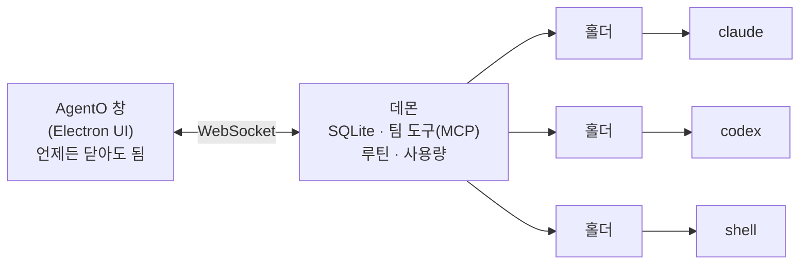
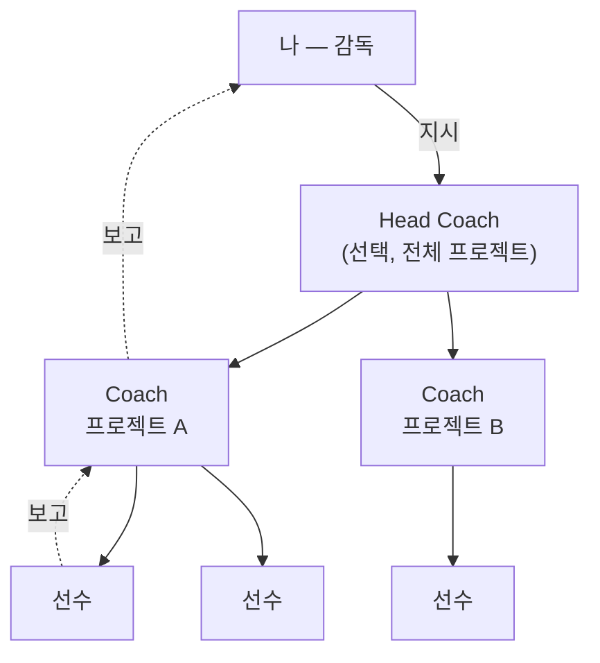

<p align="right"><a href="README.md">English</a> · <b>한국어</b> · <a href="README.zh.md">中文</a> · <a href="README.ja.md">日本語</a></p>

# AgentO

**모든 AI 코딩 에이전트를 한 보드에서.** AgentO는 Claude Code, Codex, Gemini CLI, Ollama, 일반 셸을 나란히 실행하고 작은 팀처럼 관리하게 해 주는 데스크톱 앱(Windows · macOS)입니다.

> **핵심 아이디어:** 창을 닫아도 세션은 계속 돕니다. 세션은 백그라운드 데몬이 소유하고, UI는 붙었다 떨어지는 화면일 뿐입니다.

## 왜 AgentO인가

| AgentO 없이 | AgentO와 함께 |
|---|---|
| 에이전트마다 터미널 탭, 어디에 뭐가 있는지 놓치기 쉬움 | 모든 세션이 한 캔버스(**Ground**)의 카드로 보임 |
| 터미널을 닫으면 세션도 사라짐 | UI를 닫아도 세션은 계속 일하고, 다시 열면 그대로 복원 |
| 에이전트 사이 메시지를 사람이 직접 전달 | 에이전트끼리 지시·보고를 주고받고, 나는 지시만 함 |
| 긴 대화가 조용히 토큰을 소모 | 대화 크기를 표시하고, **Fresh start**로 요약을 넘겨 새 대화 시작 |
| 무엇이 끝났는지 기록이 없음 | 타임라인, 일일 리포트, 작업 번호(`#T12`) |

세션은 각 도구의 **CLI와 본인 구독 로그인**으로만 실행합니다. AgentO는 API 키를 요구하지 않습니다.

## 동작 방식



세션마다 작은 **홀더** 프로세스가 하나씩 소유하므로, 데몬을 다시 띄워도 에이전트는 멈추지 않습니다.

## 팀 구조

당신은 **감독(Manager)** 입니다. 지시를 내리면 세션들이 일을 나누고 보고합니다.



| 역할 | 하는 일 |
|---|---|
| **감독**(나) | 지시, 질문에 답, 결정 |
| **Head Coach** | 선택 사항. 지시를 알맞은 프로젝트로 전달 |
| **Coach** | 프로젝트마다 하나. 일을 나눠 선수에게 보내고 결과를 모음 |
| **선수** | 실제 코딩. Coach는 파일을 직접 고치지 않음 |
| **검토자** | 끝난 일을 교차 검증하는 Codex 세션(새 프로젝트마다 추가) |

지시마다 작업 번호(`#T12`)가 붙어 보고까지 따라가므로, 무엇이 끝났고 무엇이 기다리는지 한눈에 보입니다.

## 주요 기능

| 영역 | 내용 |
|---|---|
| **Ground** | 세션 카드 캔버스, 프로젝트·파트 영역, 지시·보고 연결선(흐르는 점선), 미니맵, Focus 보기 |
| **보기** | Ground · Split · Tabs · Timeline(끝난 기능) · Today(지금 필요한 것) |
| **대화** | Claude·Codex 대화를 카드에서 바로: 도구 호출, 팀 메시지, 이미지, 파일 링크, 질문·권한 카드 |
| **오른쪽 패널** | Session · Files · Manager · Inbox · Logs · Web(Gemini, ChatGPT) |
| **프로젝트 메모리** | 프로젝트마다 결정·규칙·지도를 한 파일로 두고 Claude 세션 시작 때 주입 |
| **루틴** | 반복 지시(N분마다, 매일 HH:MM). UI를 닫아도 실행 |
| **토큰 관리** | 대화 크기 칩, 자동 Fresh start, 모델 선택, 사용량 리포트 |
| **Needs you** | 내 판단을 기다리는 질문·프롬프트를 한 알림으로 모아 보기 |
| **저장·가져오기** | 프로젝트를 `.agento` 파일로 저장·열기, 기존 Claude Code 세션 가져오기 |
| **파일** | Markdown · JSON · CSV · 이미지 뷰어를 파일별 새 창으로 |

## 지원 에이전트

| 에이전트 | 터미널 | 대화 보기 | 팀 구성원 | Fresh start / 사용량 리포트 |
|---|:-:|:-:|:-:|:-:|
| Claude Code | ✅ | ✅ | ✅ | ✅ |
| Codex | ✅ | ✅ | ✅ | — |
| Gemini CLI | ✅ | — | — | — |
| Ollama | ✅ | — | — | — |
| 셸 | ✅ | — | — | — |

Gemini CLI는 개인 요금제 지원이 끝나 여기서는 터미널 보기만 됩니다.

## 빠른 시작

**필요한 것:** Node.js 22(LTS), 쓸 CLI(`claude`, `codex`, `gemini`, `ollama`; `PATH`에서 자동 감지). Windows는 네이티브 모듈 빌드를 위해 Visual Studio Build Tools와 Python이 필요합니다.

```bash
git clone https://github.com/dongliquan/AgentO.git
cd AgentO
npm install        # Electron용 node-pty, better-sqlite3 빌드
npm run dev        # 앱 실행
```

그다음:

1. **Agents › Connections** 에서 Claude Code가 설치·로그인돼 있는지 확인합니다.
2. *Projects* 옆 **+** 로 프로젝트(디스크의 폴더)를 만듭니다.
3. 폴더의 **+** 로 세션을 시작하거나 **Manager** 에서 지시를 보냅니다.
4. 창을 닫고 트레이에서 다시 엽니다. 세션은 그대로 돌고 있습니다.

| 명령 | 용도 |
|---|---|
| `npm run dev` | 개발 모드 실행 |
| `npm run typecheck` | 메인·렌더러 타입 검사 |
| `npm run smoke` | 일회용 데몬으로 확인(AI 호출 없음) |
| `npm run dist:win` | Windows 설치본 + 포터블 exe → `dist/`(서명 없음) |
| `npm run dist:mac` | macOS dmg + zip (Mac에서 실행) |

`v1.0.0` 같은 태그를 push하면 GitHub Actions가 Windows·macOS 패키지를 만듭니다.

## 데이터 위치

| 항목 | 위치 |
|---|---|
| 데이터 폴더 | `%APPDATA%\AgentO` (macOS: `~/Library/Application Support/AgentO`) |
| 데이터베이스·로그 | `asm.db`, `logs/` |
| 프로젝트 메모리·팀 폴더 | `team/` |
| 붙여넣은 이미지 | `attachments/` |

데몬은 `127.0.0.1` 에서만 듣고, 모든 연결은 데이터 폴더의 무작위 토큰이 있어야 합니다.

## 단축키

| 키 | 동작 |
|---|---|
| Ctrl+N | 새 세션 |
| Ctrl+P · Ctrl+Shift+P | 빠른 열기 · 명령 팔레트 |
| Ctrl+1 … 5 | Ground · Split · Tabs · Timeline · Today |
| Ctrl+F | 찾기 |
| Ctrl+B | 사이드바 토글 |
| Ctrl+Shift+B | 패널을 별도 창으로 |
| Ctrl+Shift+W | 입력 대기 세션으로 이동 |
| F2 · F11 | 이름 바꾸기 · Focus 보기 |

## 설정(환경 변수)

| 변수 | 뜻 |
|---|---|
| `AGENTO_DATA_DIR` | 데이터 폴더 변경 |
| `ASM_PORT` | 데몬 포트(기본 47831) |
| `ASM_HIBERNATE_MIN` | 쉬는 세션이 절전하기까지 분(기본 30) |
| `AGENTO_HEADLESS=0` | 팀 세션을 headless 대신 터미널로 시작 |
| `AGENTO_PLAYER_MODEL` · `AGENTO_COACH_MODEL` | 선수 / Coach 기본 모델 |
| `AGENTO_AUTO_FRESH=0` | 자동 Fresh start 끄기 |

## 폴더 구성

| 폴더 | 내용 |
|---|---|
| `src/daemon/` | 백그라운드 데몬: WebSocket + MCP 서버, SQLite, 팀, 루틴, 사용량. `holder.ts` 가 세션 하나를 소유 |
| `src/main/` | Electron 메인: 창, 메뉴, 트레이, 데몬 기동, 딥링크 |
| `src/preload/` | 메인과 UI 사이의 안전한 다리 |
| `src/renderer/` | React + zustand + xterm UI |
| `src/shared/` | 메시지 규약과 공용 코드 |
| `tests/smoke/` | 데몬·UI 스모크 테스트 |
| `docs/` | 설계 문서 |

## 알려진 한계

- 코드 서명이 아직 없습니다. Windows는 SmartScreen 경고가 뜨고, macOS는 직접 열어야 합니다.
- 사용량은 로컬 대화 기록 기준입니다. 구독의 남은 한도는 알 수 없습니다.
- 자동 업데이트와 "A가 끝나면 B 시작" 연결은 아직 없습니다.
- 팀 기능은 주로 Claude Code로 써 봤고, Codex·Gemini Coach 구성은 검증이 덜 됐습니다.

## 보안

AgentO와 연결한 CLI는 내 파일에 접근할 수 있습니다. 에이전트는 내가 준 권한으로 동작하니 권한 요청을 확인하고, *Trust this folder* 는 직접 관리하는 폴더에만 쓰세요. 취약점은 공개 이슈 대신 GitHub의 *Report a vulnerability* 로 비공개 제보해 주세요.

## 라이선스

[MIT](LICENSE) © dongliquan
