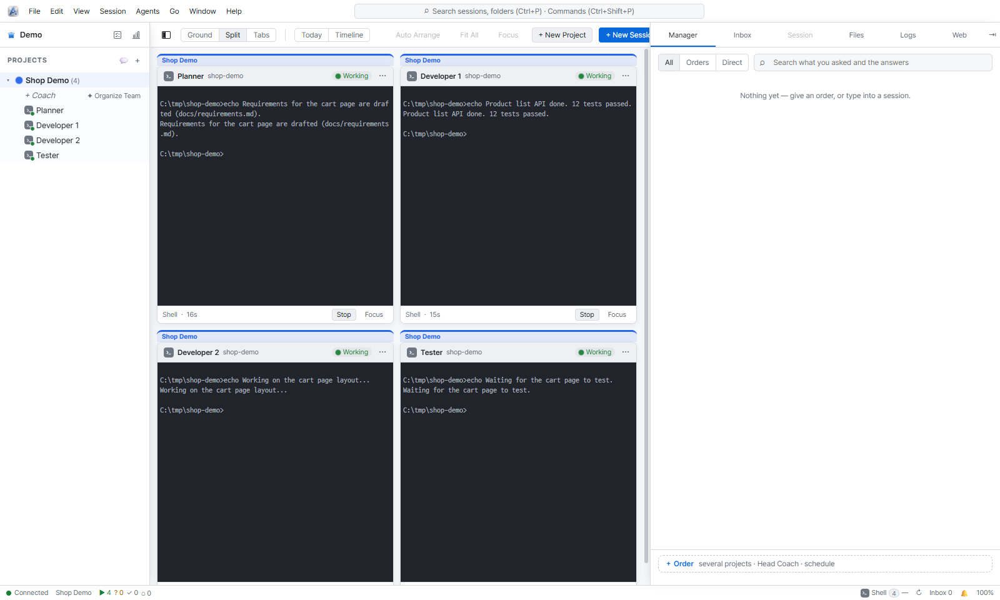
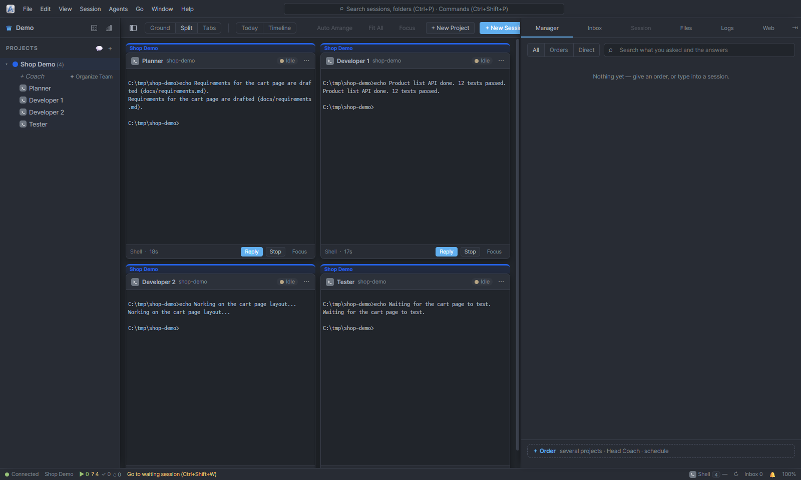
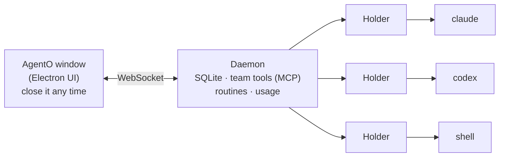
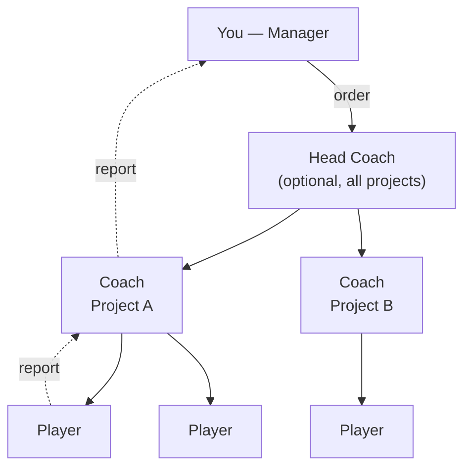

<p align="right"><b>English</b> · <a href="README.ko.md">한국어</a> · <a href="README.zh.md">中文</a> · <a href="README.ja.md">日本語</a></p>

# AgentO

**One board for all your AI coding agents.** AgentO is a desktop app (Windows · macOS) that runs Claude Code, Codex, Gemini CLI, Ollama and plain shells side by side, and lets you manage them like a small team.

> **The key idea:** close the window and your sessions keep running. A background daemon owns every session; the UI is just a window that attaches and detaches.

## Download

Get the latest build from **[Releases](https://github.com/dongliquan/AgentO/releases/latest)**. You still need the CLIs you want to run (Claude Code, Codex, …) installed and signed in.

| Platform | File |
|---|---|
| Windows (installer) | `AgentO-<version>-win-x64-setup.exe` |
| Windows (no install) | `AgentO-<version>-win-x64-portable.exe` |
| macOS, Apple Silicon | `AgentO-<version>-mac-arm64.dmg` |
| macOS, Intel | `AgentO-<version>-mac-x64.dmg` |

**The builds are not code-signed yet, so the first launch shows a warning:**

- **Windows:** SmartScreen says "Windows protected your PC". Click **More info → Run anyway**, or right-click the downloaded file → Properties → tick **Unblock** (PowerShell: `Unblock-File <file>`).
- **macOS:** Right-click the app, choose **Open**, then **Open** again. Or run `xattr -dr com.apple.quarantine /Applications/AgentO.app`.

To build from source instead, see [Quick start](#quick-start).

## Screenshots

| Light | Dark |
|:-:|:-:|
|  |  |

<sub>Four sessions of a demo project in the Split view (plain shell sessions stand in for AI agents here). Light and dark themes.</sub>

## Why AgentO

| Without AgentO | With AgentO |
|---|---|
| One terminal tab per agent, easy to lose track | Every session is a card on one canvas (the **Ground**) |
| Close the terminal, lose the session | Close the UI, sessions keep working; reopen and everything is back |
| You relay messages between agents by hand | Agents send tasks and reports to each other; you only give orders |
| Long chats quietly burn tokens | Chat size is shown; **Fresh start** hands off to a new chat with a summary |
| No record of what got done | Timeline, daily report and per-task numbers (`#T12`) |

Sessions are driven through each tool's **CLI with your own subscription login**. AgentO never asks for an API key.

## How it works



Each session lives in its own small **holder** process, so even restarting the daemon does not stop your agents.

## The team model

You are the **Manager**. Give an order, and the sessions split the work and report back.



| Role | What it does |
|---|---|
| **Manager** (you) | Gives orders, answers questions, decides |
| **Head Coach** | Optional. Routes an order to the right project |
| **Coach** | One per project. Splits work, sends it to players, collects results |
| **Player** | Does the actual coding. A Coach does not edit files |
| **Reviewer** | A Codex session that cross-checks finished work (added to each new project) |

Every order gets a task number (`#T12`) that follows it through the reports, so you can see what is done and what is waiting.

## Features

| Area | What you get |
|---|---|
| **Ground** | Canvas of session cards, project/part areas, animated order and report lines, minimap, focus mode |
| **Views** | Ground · Split · Tabs · Timeline (finished features) · Today (what needs you now) |
| **Chat** | Read Claude/Codex chats on the card: tool calls, team messages, images, file links, question and permission cards |
| **Right panel** | Session · Files · Manager · Inbox · Logs · Web (Gemini, ChatGPT) |
| **Project memory** | One file per project (decisions, rules, map) injected into Claude sessions at start |
| **Routines** | Recurring orders (every N minutes, daily at HH:MM); run even when the UI is closed |
| **Token control** | Chat-size chips, automatic Fresh start, model picker, usage report |
| **Needs you** | Questions and prompts that wait for your decision are gathered in one alert |
| **Save / import** | Save a project as a `.agento` file; import existing Claude Code sessions |
| **Files** | Markdown, JSON, CSV and image viewers, each in its own window |

## Supported agents

| Agent | Terminal | Chat view | Team member | Fresh start / usage report |
|---|:-:|:-:|:-:|:-:|
| Claude Code | ✅ | ✅ | ✅ | ✅ |
| Codex | ✅ | ✅ | ✅ | — |
| Gemini CLI | ✅ | — | — | — |
| Ollama | ✅ | — | — | — |
| Shell | ✅ | — | — | — |

Gemini CLI ended personal-plan support, so it is terminal-only here.

## Quick start

**Requirements:** Node.js 22 (LTS), and the CLIs you want to use (`claude`, `codex`, `gemini`, `ollama`; found on your `PATH`). On Windows, native modules need Visual Studio Build Tools and Python.

```bash
git clone https://github.com/dongliquan/AgentO.git
cd AgentO
npm install        # builds node-pty and better-sqlite3 for Electron
npm run dev        # starts the app
```

Then:

1. Open **Agents › Connections** and make sure Claude Code is installed and signed in.
2. Click **+** next to *Projects* and create a project (a folder on your disk).
3. Click **+** on the folder to start a session, or use **Manager** to give an order.
4. Close the window, then reopen it from the tray. The sessions are still running.

| Command | Purpose |
|---|---|
| `npm run dev` | Run in development mode |
| `npm run typecheck` | Type-check main and renderer |
| `npm run smoke` | Start a throwaway daemon and run checks (no AI calls) |
| `npm run dist:win` | Windows installer + portable exe → `dist/` (unsigned) |
| `npm run dist:mac` | macOS dmg + zip (run on a Mac) |

Pushing a tag like `v1.0.0` builds Windows and macOS packages via GitHub Actions.

## Where your data lives

| Item | Location |
|---|---|
| Data folder | `%APPDATA%\AgentO` (macOS: `~/Library/Application Support/AgentO`) |
| Database, logs | `asm.db`, `logs/` |
| Project memory, team folders | `team/` |
| Pasted images | `attachments/` |

The daemon listens on `127.0.0.1` only, and every connection needs a random token stored in the data folder.

## Keyboard shortcuts

| Keys | Action |
|---|---|
| Ctrl+N | New session |
| Ctrl+P · Ctrl+Shift+P | Quick open · Command palette |
| Ctrl+1 … 5 | Ground · Split · Tabs · Timeline · Today |
| Ctrl+F | Find |
| Ctrl+B | Toggle sidebar |
| Ctrl+Shift+B | Panels in a separate window |
| Ctrl+Shift+W | Jump to a session waiting for input |
| F2 · F11 | Rename · Focus view |

## Settings (environment variables)

| Variable | Meaning |
|---|---|
| `AGENTO_DATA_DIR` | Use a different data folder |
| `ASM_PORT` | Daemon port (default 47831) |
| `ASM_HIBERNATE_MIN` | Minutes before an idle session sleeps (default 30) |
| `AGENTO_HEADLESS=0` | Start team sessions in a terminal instead of headless |
| `AGENTO_PLAYER_MODEL` · `AGENTO_COACH_MODEL` | Default model for players / coaches |
| `AGENTO_AUTO_FRESH=0` | Turn off automatic Fresh start |

## Project layout

| Folder | Content |
|---|---|
| `src/daemon/` | Background daemon: WebSocket + MCP server, SQLite, team, routines, usage; `holder.ts` owns one session |
| `src/main/` | Electron main: windows, menu, tray, daemon start, deep links |
| `src/preload/` | Safe bridge between main and UI |
| `src/renderer/` | React + zustand + xterm UI |
| `src/shared/` | Message protocol and shared helpers |
| `tests/smoke/` | Daemon and UI smoke tests |
| `docs/` | Design notes |

## Known limits

- Builds are not code-signed yet: Windows SmartScreen will warn, and macOS needs a manual open.
- Usage numbers come from local chat logs; your subscription's remaining quota is not visible.
- No auto-update and no "run B when A finishes" chains yet.
- Team features were tried mainly with Claude Code; Codex and Gemini coach setups are less tested.

## Security

Windows, macOS, and the CLIs you connect are trusted to act on your files. Agents run with the permissions you give them: review permission prompts, and use *Trust this folder* only for folders you control. Please report vulnerabilities privately through GitHub's *Report a vulnerability* button instead of a public issue.

## License

[MIT](LICENSE) © dongliquan
