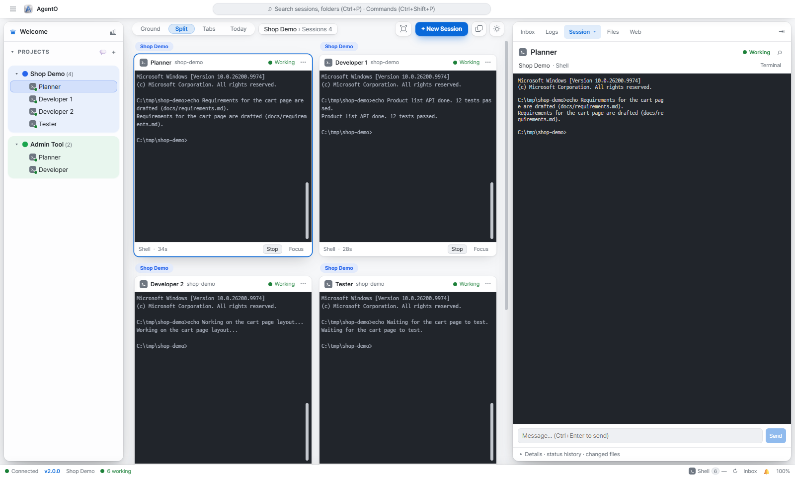
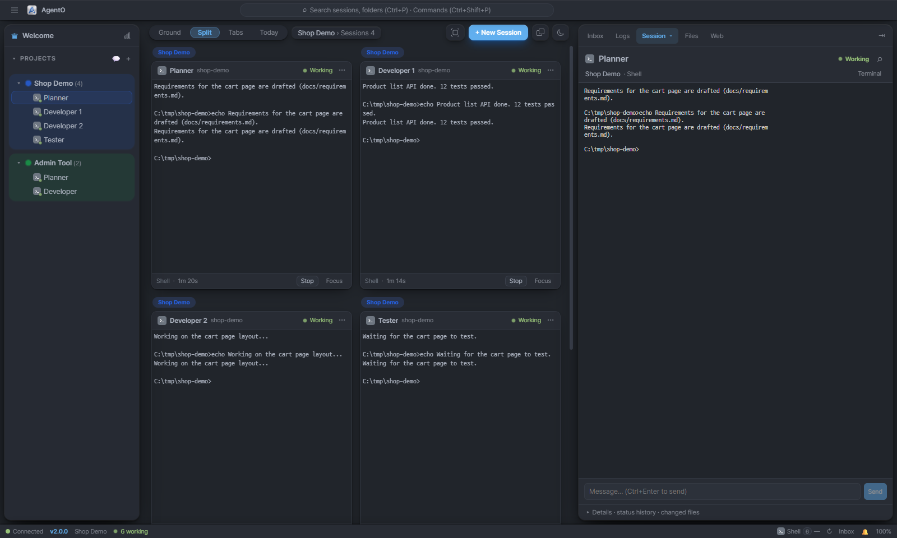
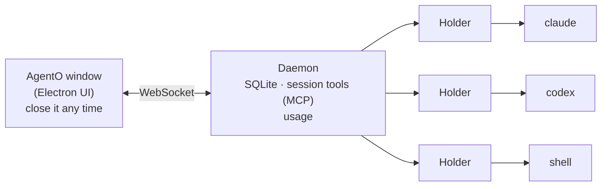
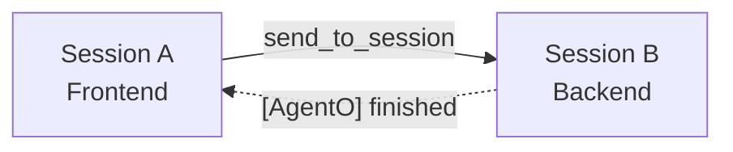

<p align="right"><b>English</b> · <a href="README.ko.md">한국어</a> · <a href="README.zh.md">中文</a> · <a href="README.ja.md">日本語</a></p>

# AgentO

**One place for all your AI coding sessions.** AgentO is a desktop app (Windows · macOS) that runs Claude Code, Codex, Gemini CLI, Ollama and plain shells side by side, keeps them alive, and lets them ask each other for help.

> **The key idea:** close the window and your sessions keep running. A background daemon owns every session; the UI is just a window that attaches and detaches.

## Download

Get the latest build from **[Releases](https://github.com/dongliquan/AgentO/releases/latest)**. You still need the CLIs you want to run (Claude Code, Codex, …) installed and signed in.

| Platform | File |
|---|---|
| Windows (installer) | `AgentO-<version>-win-x64-setup.exe` |
| Windows (no install) | `AgentO-<version>-win-x64-portable.exe` |
| macOS, Apple Silicon | `AgentO-<version>-mac-arm64.dmg` |
| macOS, Intel | `AgentO-<version>-mac-x64.dmg` |

**The builds are not code-signed yet, so the first launch shows a warning:**

- **Windows:** SmartScreen says "Windows protected your PC". Click **More info → Run anyway**, or right-click the downloaded file → Properties → tick **Unblock** (PowerShell: `Unblock-File <file>`).
- **macOS:** Right-click the app, choose **Open**, then **Open** again. Or run `xattr -dr com.apple.quarantine /Applications/AgentO.app`.

To build from source instead, see [Quick start](#quick-start).

## Screenshots

| Light | Dark |
|:-:|:-:|
|  |  |

<sub>Four sessions of a demo project in the Split view (plain shell sessions stand in for AI agents here). Light and dark themes.</sub>

## Why AgentO

| Without AgentO | With AgentO |
|---|---|
| One terminal tab per agent, easy to lose track | Every session is a card on one canvas (the **Ground**), or a tab, or a split |
| Close the terminal, lose the session | Close the UI, sessions keep working; reopen and everything is back |
| You relay messages between agents by hand | A session can ask another session of its project for something and gets the answer back |
| Long chats quietly burn tokens | Chat size is shown; **Fresh start** hands off to a new chat with a summary |
| After a restart you forget where each session stopped | **Pick up where you left off** lists stopped sessions with what each was last asked and where it ended |
| Your computer goes to sleep and everything stops | AgentO keeps the computer awake while sessions work (a locked screen is fine) |

Sessions are driven through each tool's **CLI with your own subscription login**. AgentO never asks for an API key.

## How it works



Each session lives in its own small **holder** process, so even restarting the daemon does not stop your agents. A holder runs from its own copy of the runtime in the data folder, so replacing the app never stops sessions and old build folders do not pile up.

## Sessions that ask each other

Every Claude Code, Codex and Gemini session gets a few tools through MCP. No hierarchy, no manager: a session just asks another one.



- `list_sessions` shows the other sessions of the same project; `read_session` shows what one of them is doing.
- `send_to_session` sends a request. When the other session finishes, its last answer comes back to the asker as an `[AgentO] … finished` message, with a task number (`#T12`).
- `report_up` answers or asks back; `update_memory` adds a line to the project memory that every session gets at start.

## Features

| Area | What you get |
|---|---|
| **Ground** | Canvas of session cards (the side panels float over it and fold to their title), project areas, minimap, focus mode. Auto Arrange deals projects into columns by session count |
| **Views** | Ground · Split · Tabs · Today (what needs you now) |
| **Pick up** | Stopped sessions with what each was last asked and where it ended; **Resume all** after a restart |
| **Chat** | Read Claude/Codex/Gemini chats on the card: tool calls, messages from other sessions, images, file links, question and permission cards |
| **Right panel** | Session · Files · Inbox · Logs · Web (Gemini, ChatGPT) |
| **Logs** | What the sessions asked of each other and how it ended (`#T` number, the messages that went back and forth); on the Ground a line and an arrow between their cards |
| **Scheduled messages** | Type a message into a session every N minutes, daily or once, even with no window open (card menu › Scheduled messages…) |
| **Project memory** | One file per project (decisions, rules, map) injected into Claude sessions at start |
| **Autopilot** | Let one session keep going while you are away: it writes down what "finished" means, works through what is open, stops by itself |
| **Token control** | Chat-size chips, automatic Fresh start, model picker, usage report |
| **Needs you** | Questions and prompts that wait for your decision are gathered in one alert; a session waiting for you is never put to sleep |
| **Save / import** | Save a project as a `.agento` file; import existing Claude Code sessions |
| **Files** | Markdown, JSON, CSV and image viewers, each in its own window |

## Supported agents

| Agent | Terminal | Chat view | Ask other sessions | Fresh start / usage report |
|---|:-:|:-:|:-:|:-:|
| Claude Code | ✅ | ✅ | ✅ | ✅ |
| Codex | ✅ | ✅ | ✅ | — |
| Gemini CLI | ✅ | ✅ | ✅ | — |
| Ollama | ✅ | — | — | — |
| Shell | ✅ | — | — | — |

Gemini CLI ended personal-plan support: it works with a Code Assist account or an API key you provide (the CLI keeps the key, AgentO never asks for one). Pick a model per session (`pro`, `flash`, `flash-lite`); the tools to ask other sessions are on only in folders the CLI trusts.

## Quick start

**Requirements:** Node.js 22 (LTS), and the CLIs you want to use (`claude`, `codex`, `gemini`, `ollama`; found on your `PATH`). On Windows, native modules need Visual Studio Build Tools and Python.

```bash
git clone https://github.com/dongliquan/AgentO.git
cd AgentO
npm install        # builds node-pty and better-sqlite3 for Electron
npm run dev        # starts the app
```

Then:

1. Open **Agents › Connections** and make sure Claude Code is installed and signed in.
2. Click **+** next to *Projects* and create a project (a folder on your disk).
3. Click **+** on the folder to start a session.
4. Close the window, then reopen it from the tray. The sessions are still running.

| Command | Purpose |
|---|---|
| `npm run dev` | Run in development mode |
| `npm run typecheck` | Type-check main and renderer |
| `npm run smoke` | Start a throwaway daemon and run checks (no AI calls) |
| `npm run dist:win` | Windows installer + portable exe → `dist/` (unsigned) |
| `npm run dist:mac` | macOS dmg + zip (run on a Mac) |

Pushing a tag like `v1.1.0` builds Windows and macOS packages via GitHub Actions.

## Where your data lives

| Item | Location |
|---|---|
| Data folder | `%APPDATA%\AgentO` (macOS: `~/Library/Application Support/AgentO`) |
| Database, logs | `asm.db`, `logs/` |
| Project memory, session tool configs | `team/` |
| Pasted images | `attachments/` |
| Holders' own runtime copy | `runtime/` |

The daemon listens on `127.0.0.1` only, and every connection needs a random token stored in the data folder.

## Keyboard shortcuts

| Keys | Action |
|---|---|
| Ctrl+N | New session |
| Ctrl+P · Ctrl+Shift+P | Quick open · Command palette |
| Ctrl+1 … 4 | Ground · Split · Tabs · Today |
| Ctrl+F | Find |
| Ctrl+B · Ctrl+Alt+B | Fold / unfold the left sidebar · the right panel |
| Ctrl+Shift+B | Panels in a separate window |
| Ctrl+Shift+W | Jump to a session waiting for input |
| F2 · F11 | Rename · Focus view |

## Settings (environment variables)

| Variable | Meaning |
|---|---|
| `AGENTO_DATA_DIR` | Use a different data folder |
| `ASM_PORT` | Daemon port (default 47831) |
| `ASM_HIBERNATE_MIN` | Minutes before an idle session sleeps (default 30) |
| `AGENTO_PLAYER_MODEL` | Default Claude model when none is picked (default Opus 5.5) |
| `AGENTO_AUTO_FRESH=0` | Turn off automatic Fresh start |
| `AGENTO_KEEP_AWAKE=0` | Do not keep the computer awake while sessions work |
| `AGENTO_HOLDER_RUNTIME=0` | Run holders from the build folder instead of the data folder |

## Project layout

| Folder | Content |
|---|---|
| `src/daemon/` | Background daemon: WebSocket + MCP server, SQLite, usage; `holder.ts` owns one session |
| `src/main/` | Electron main: windows, menu, tray, daemon start, deep links |
| `src/preload/` | Safe bridge between main and UI |
| `src/renderer/` | React + zustand + xterm UI |
| `src/shared/` | Message protocol and shared helpers |
| `tests/smoke/` | Daemon and UI smoke tests |
| `docs/` | Design notes |

## Known limits

- Builds are not code-signed yet: Windows SmartScreen will warn, and macOS needs a manual open.
- Usage numbers come from local chat logs; your subscription's remaining quota is not visible.
- No auto-update and no "run B when A finishes" chains yet.
- Sessions asking each other were tried mainly with Claude Code; Codex and Gemini are less tested.

## Security

Windows, macOS, and the CLIs you connect are trusted to act on your files. Agents run with the permissions you give them: review permission prompts, and use *Trust this folder* only for folders you control. Please report vulnerabilities privately through GitHub's *Report a vulnerability* button instead of a public issue.

## License

[MIT](LICENSE) © dongliquan
