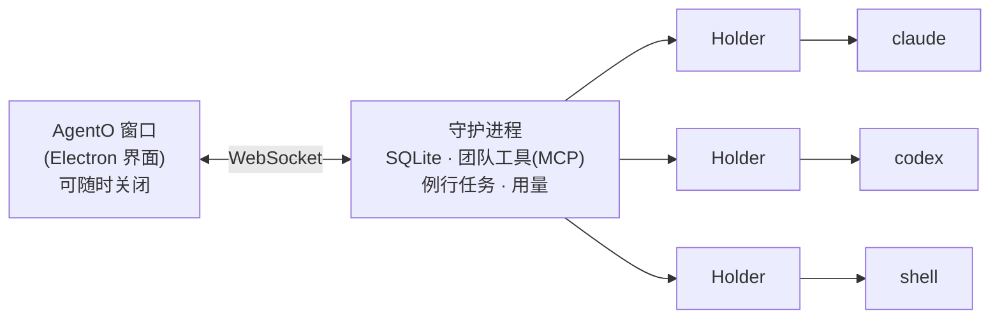
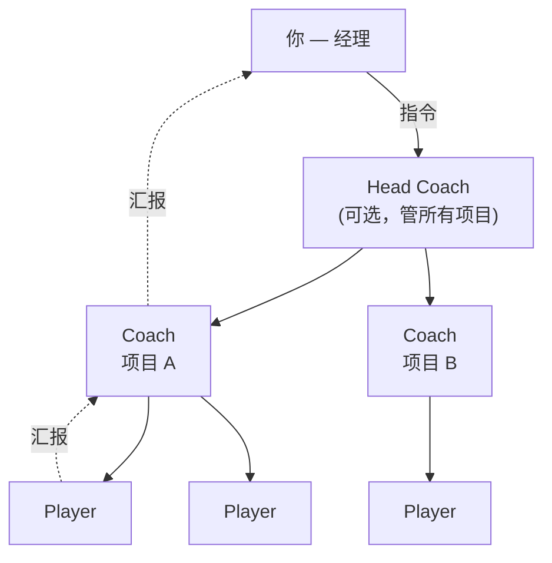

<p align="right"><a href="README.md">English</a> · <a href="README.ko.md">한국어</a> · <b>中文</b> · <a href="README.ja.md">日本語</a></p>

# AgentO

**一块看板，管理所有 AI 编程代理。** AgentO 是一款桌面应用（Windows · macOS），可以并排运行 Claude Code、Codex、Gemini CLI、Ollama 和普通 Shell，并像管理小团队一样管理它们。

> **核心理念：** 关闭窗口，会话继续运行。所有会话由后台守护进程持有，界面只是可以随时连接和断开的窗口。

## 为什么用 AgentO

| 没有 AgentO | 有了 AgentO |
|---|---|
| 每个代理一个终端标签，容易迷失 | 所有会话都是同一画布（**Ground**）上的卡片 |
| 关掉终端，会话就没了 | 关闭界面，会话继续工作；重新打开一切照旧 |
| 代理之间的消息要人工转达 | 代理之间互相派活、汇报，你只负责下达指令 |
| 长对话悄悄消耗 token | 显示对话大小；**Fresh start** 带着摘要开启新对话 |
| 做完了什么没有记录 | 时间线、每日报告、任务编号（`#T12`） |

会话通过各工具的 **CLI 和你自己的订阅登录**运行。AgentO 从不索要 API 密钥。

## 工作原理



每个会话由各自的小型 **holder** 进程持有，所以即使重启守护进程，代理也不会停下。

## 团队模型

你是**经理（Manager）**。下达指令后，会话们会分工并汇报。



| 角色 | 职责 |
|---|---|
| **经理**（你） | 下达指令、回答问题、做决定 |
| **Head Coach** | 可选。把指令转给合适的项目 |
| **Coach** | 每个项目一个。拆分工作、派给 Player、汇总结果 |
| **Player** | 实际编写代码。Coach 不直接改文件 |
| **Reviewer** | 交叉检查已完成工作的 Codex 会话（每个新项目自动加入） |

每条指令都有任务编号（`#T12`），贯穿整个汇报过程，一眼就能看出哪些完成、哪些在等待。

## 功能

| 领域 | 内容 |
|---|---|
| **Ground** | 会话卡片画布、项目/分区区域、流动的指令与汇报连线、小地图、专注模式 |
| **视图** | Ground · Split · Tabs · Timeline（已完成的功能）· Today（现在需要你的事） |
| **对话** | 直接在卡片上查看 Claude/Codex 对话：工具调用、团队消息、图片、文件链接、提问与权限卡片 |
| **右侧面板** | Session · Files · Manager · Inbox · Logs · Web（Gemini、ChatGPT） |
| **项目记忆** | 每个项目一个文件（决定、规则、地图），在 Claude 会话启动时注入 |
| **例行任务** | 周期性指令（每 N 分钟、每天 HH:MM），关闭界面也会执行 |
| **Token 控制** | 对话大小标记、自动 Fresh start、模型选择、用量报告 |
| **Needs you** | 等待你决定的提问和提示集中在一个提醒里 |
| **保存/导入** | 项目可保存为 `.agento` 文件；可导入已有的 Claude Code 会话 |
| **文件** | Markdown、JSON、CSV、图片查看器，每个文件独立窗口 |

## 支持的代理

| 代理 | 终端 | 对话视图 | 团队成员 | Fresh start / 用量报告 |
|---|:-:|:-:|:-:|:-:|
| Claude Code | ✅ | ✅ | ✅ | ✅ |
| Codex | ✅ | ✅ | ✅ | — |
| Gemini CLI | ✅ | — | — | — |
| Ollama | ✅ | — | — | — |
| Shell | ✅ | — | — | — |

Gemini CLI 已终止个人套餐支持，因此这里只提供终端视图。

## 快速开始

**环境要求：** Node.js 22（LTS），以及你要用的 CLI（`claude`、`codex`、`gemini`、`ollama`，从 `PATH` 自动检测）。Windows 上编译原生模块需要 Visual Studio Build Tools 和 Python。

```bash
git clone https://github.com/dongliquan/AgentO.git
cd AgentO
npm install        # 为 Electron 编译 node-pty 和 better-sqlite3
npm run dev        # 启动应用
```

然后：

1. 打开 **Agents › Connections**，确认 Claude Code 已安装并登录。
2. 点击 *Projects* 旁的 **+**，创建项目（磁盘上的一个文件夹）。
3. 点击文件夹上的 **+** 启动会话，或在 **Manager** 中下达指令。
4. 关闭窗口，再从托盘重新打开。会话仍在运行。

| 命令 | 用途 |
|---|---|
| `npm run dev` | 开发模式运行 |
| `npm run typecheck` | 检查主进程和渲染进程类型 |
| `npm run smoke` | 启动一次性守护进程做检查（不调用 AI） |
| `npm run dist:win` | Windows 安装包 + 便携 exe → `dist/`（未签名） |
| `npm run dist:mac` | macOS dmg + zip（需在 Mac 上运行） |

推送 `v1.0.0` 这样的标签，GitHub Actions 会构建 Windows 和 macOS 安装包。

## 数据位置

| 项目 | 位置 |
|---|---|
| 数据文件夹 | `%APPDATA%\AgentO`（macOS：`~/Library/Application Support/AgentO`） |
| 数据库、日志 | `asm.db`、`logs/` |
| 项目记忆、团队文件夹 | `team/` |
| 粘贴的图片 | `attachments/` |

守护进程只监听 `127.0.0.1`，每个连接都需要数据文件夹中的随机令牌。

## 快捷键

| 按键 | 操作 |
|---|---|
| Ctrl+N | 新建会话 |
| Ctrl+P · Ctrl+Shift+P | 快速打开 · 命令面板 |
| Ctrl+1 … 5 | Ground · Split · Tabs · Timeline · Today |
| Ctrl+F | 查找 |
| Ctrl+B | 切换侧边栏 |
| Ctrl+Shift+B | 面板独立窗口 |
| Ctrl+Shift+W | 跳到等待输入的会话 |
| F2 · F11 | 重命名 · 专注视图 |

## 设置（环境变量）

| 变量 | 含义 |
|---|---|
| `AGENTO_DATA_DIR` | 使用其他数据文件夹 |
| `ASM_PORT` | 守护进程端口（默认 47831） |
| `ASM_HIBERNATE_MIN` | 空闲会话休眠前的分钟数（默认 30） |
| `AGENTO_HEADLESS=0` | 团队会话改用终端而非 headless 启动 |
| `AGENTO_PLAYER_MODEL` · `AGENTO_COACH_MODEL` | Player / Coach 的默认模型 |
| `AGENTO_AUTO_FRESH=0` | 关闭自动 Fresh start |

## 目录结构

| 文件夹 | 内容 |
|---|---|
| `src/daemon/` | 后台守护进程：WebSocket + MCP 服务、SQLite、团队、例行任务、用量；`holder.ts` 持有单个会话 |
| `src/main/` | Electron 主进程：窗口、菜单、托盘、启动守护进程、深链接 |
| `src/preload/` | 主进程与界面之间的安全桥接 |
| `src/renderer/` | React + zustand + xterm 界面 |
| `src/shared/` | 消息协议与公共代码 |
| `tests/smoke/` | 守护进程与界面的冒烟测试 |
| `docs/` | 设计文档 |

## 已知限制

- 构建尚未做代码签名：Windows 会弹出 SmartScreen 警告，macOS 需要手动打开。
- 用量数据来自本地对话记录，看不到订阅的剩余额度。
- 暂无自动更新，也没有“A 完成后启动 B”的串联。
- 团队功能主要用 Claude Code 试过，Codex 和 Gemini 作为 Coach 的配置验证较少。

## 安全

AgentO 以及你连接的 CLI 都能操作你的文件。代理按你授予的权限运行：请认真查看权限请求，*Trust this folder* 只用于你自己掌控的文件夹。发现漏洞请通过 GitHub 的 *Report a vulnerability* 私下报告，不要公开提交 issue。

## 许可证

[MIT](LICENSE) © dongliquan
