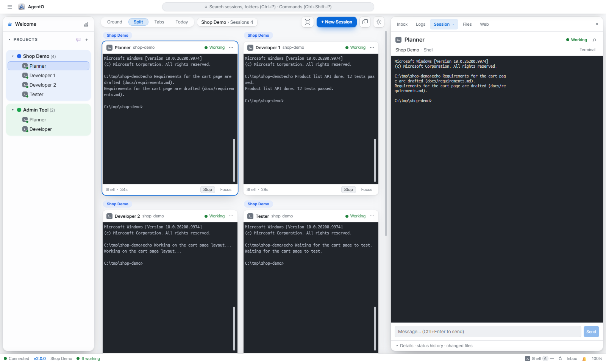
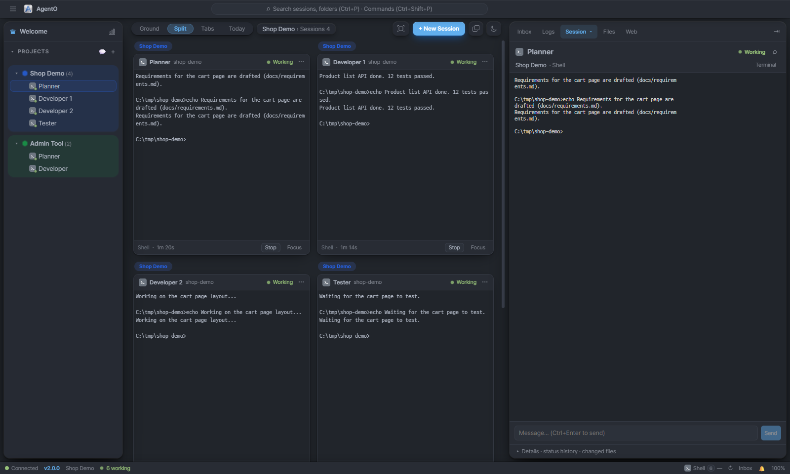
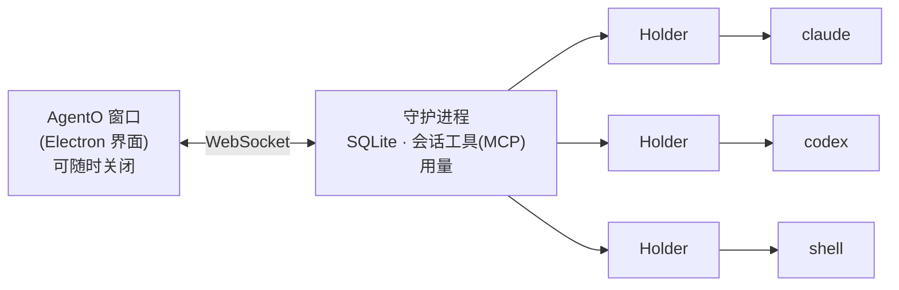
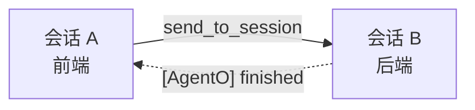

<p align="right"><a href="README.md">English</a> · <a href="README.ko.md">한국어</a> · <b>中文</b> · <a href="README.ja.md">日本語</a></p>

# AgentO

**所有 AI 编程会话的统一入口。** AgentO 是一款桌面应用(Windows · macOS),可并排运行 Claude Code、Codex、Gemini CLI、Ollama 和普通 shell,让会话持续运行,并让它们互相请求帮助。

> **核心理念:** 关闭窗口,会话继续运行。后台守护进程拥有所有会话,界面只是一个可以连接和断开的窗口。

## 下载

请从 **[Releases](https://github.com/dongliquan/AgentO/releases/latest)** 获取最新版本。你仍需自行安装并登录要运行的 CLI(Claude Code、Codex 等)。

| 平台 | 文件 |
|---|---|
| Windows(安装包) | `AgentO-<version>-win-x64-setup.exe` |
| Windows(免安装) | `AgentO-<version>-win-x64-portable.exe` |
| macOS,Apple Silicon | `AgentO-<version>-mac-arm64.dmg` |
| macOS,Intel | `AgentO-<version>-mac-x64.dmg` |

**构建版本尚未进行代码签名,首次启动会出现警告:**

- **Windows:** SmartScreen 提示“Windows 已保护你的电脑”。点击**更多信息 → 仍要运行**,或右键下载的文件 → 属性 → 勾选**解除锁定**(PowerShell:`Unblock-File <文件>`)。
- **macOS:** 右键点击应用,选择**打开**,再点一次**打开**。或运行 `xattr -dr com.apple.quarantine /Applications/AgentO.app`。

如需从源码构建,请参阅[快速开始](#快速开始)。

## 截图

| Light | Dark |
|:-:|:-:|
|  |  |

<sub>演示项目的四个会话,Split 视图(这里用普通 shell 会话代替 AI 代理)。浅色与深色主题。</sub>

## 为什么用 AgentO

| 没有 AgentO | 使用 AgentO |
|---|---|
| 每个代理一个终端标签页,容易弄丢 | 每个会话都是同一画布(**Ground**)上的卡片,也可以是标签页或分屏 |
| 关掉终端就丢了会话 | 关闭界面,会话继续工作;重新打开,一切如初 |
| 代理之间的消息靠你手动转发 | 会话可以向同一项目的其他会话提出请求,并收到回答 |
| 过长的对话悄悄消耗 token | 显示对话大小;**Fresh start** 带着摘要交接到新对话 |
| 重启后忘了每个会话停在哪里 | **Pick up where you left off** 列出已停止的会话,以及各自最后的请求和停下的位置 |

会话通过各工具的 **CLI 和你自己的订阅登录**来驱动。AgentO 从不索要 API 密钥。

## 工作原理



每个会话都在自己的小型 **holder** 进程中,因此重启守护进程也不会让代理停下。

## 互相请求的会话

每个 Claude Code 和 Codex 会话都会通过 MCP 获得几个工具。没有层级,没有管理者:会话直接向另一个会话提出请求。



- `list_sessions` 显示同一项目的其他会话;`read_session` 显示其中某个会话在做什么。
- `send_to_session` 发送请求。对方完成后,它的最后一条回答会以 `[AgentO] … finished` 消息和任务编号(`#T12`)回到发出请求的会话。
- `report_up` 用于回答或追问;`update_memory` 向项目记忆添加一行,所有会话启动时都会收到。

## 功能

| 方面 | 你得到什么 |
|---|---|
| **Ground** | 会话卡片画布、项目区域、小地图、专注模式 |
| **视图** | Ground · Split · Tabs · Today(现在需要你处理的事) |
| **接着做** | 已停止的会话及各自最后的请求和停下的位置;重启后 **Resume all** |
| **Chat** | 在卡片上阅读 Claude/Codex 对话:工具调用、其他会话的消息、图片、文件链接、提问与权限卡片 |
| **右侧面板** | Session · Files · Inbox · Web(Gemini、ChatGPT) |
| **项目记忆** | 每个项目一个文件(决定、规则、地图),在 Claude 会话启动时注入 |
| **Autopilot** | 你不在时让一个会话继续推进:先写下“完成”的标准,处理未完成的事项,然后自行停止 |
| **Token 管理** | 对话大小标记、自动 Fresh start、模型选择、用量报告 |
| **需要你** | 等待你决定的问题和提示集中在一个提醒里;正在等你的会话绝不会被休眠 |
| **保存 / 导入** | 将项目保存为 `.agento` 文件;导入现有的 Claude Code 会话 |
| **文件** | Markdown、JSON、CSV 和图片查看器,各自在独立窗口中 |

## 支持的代理

| Agent | Terminal | 对话视图 | 可请求其他会话 | Fresh start / 用量报告 |
|---|:-:|:-:|:-:|:-:|
| Claude Code | ✅ | ✅ | ✅ | ✅ |
| Codex | ✅ | ✅ | ✅ | — |
| Gemini CLI | ✅ | — | — | — |
| Ollama | ✅ | — | — | — |
| Shell | ✅ | — | — | — |

Gemini CLI 已停止支持个人套餐,因此这里仅提供终端。

## 快速开始

**要求:** Node.js 22(LTS),以及你要使用的 CLI(`claude`、`codex`、`gemini`、`ollama`;需在 `PATH` 中)。在 Windows 上,原生模块需要 Visual Studio Build Tools 和 Python。

```bash
git clone https://github.com/dongliquan/AgentO.git
cd AgentO
npm install        # builds node-pty and better-sqlite3 for Electron
npm run dev        # starts the app
```

然后:

1. 打开 **Agents › Connections**,确认 Claude Code 已安装并登录。
2. 点击 *Projects* 旁的 **+**,创建一个项目(磁盘上的一个文件夹)。
3. 点击文件夹上的 **+** 启动会话。
4. 关闭窗口,再从托盘重新打开。会话仍在运行。

| 命令 | 用途 |
|---|---|
| `npm run dev` | 以开发模式运行 |
| `npm run typecheck` | 检查 main 与 renderer 的类型 |
| `npm run smoke` | 启动一次性守护进程并运行检查(不调用 AI) |
| `npm run dist:win` | Windows 安装包 + 便携版 exe → `dist/`(未签名) |
| `npm run dist:mac` | macOS dmg + zip(在 Mac 上运行) |

推送 `v1.1.0` 这样的标签,GitHub Actions 会构建 Windows 和 macOS 安装包。

## 数据存放位置

| 项目 | 位置 |
|---|---|
| 数据文件夹 | `%APPDATA%\AgentO` (macOS:`~/Library/Application Support/AgentO`) |
| 数据库、日志 | `asm.db`, `logs/` |
| 项目记忆、会话工具配置 | `team/` |
| 粘贴的图片 | `attachments/` |

守护进程只监听 `127.0.0.1`,每个连接都需要保存在数据文件夹中的随机令牌。

## 键盘快捷键

| 按键 | 操作 |
|---|---|
| Ctrl+N | 新建会话 |
| Ctrl+P · Ctrl+Shift+P | 快速打开 · 命令面板 |
| Ctrl+1 … 4 | Ground · Split · Tabs · Today |
| Ctrl+F | 查找 |
| Ctrl+B | 切换侧边栏 |
| Ctrl+Shift+B | 面板独立窗口 |
| Ctrl+Shift+W | 跳转到等待输入的会话 |
| F2 · F11 | 重命名 · 专注视图 |

## 设置(环境变量)

| 变量 | 含义 |
|---|---|
| `AGENTO_DATA_DIR` | 使用其他数据文件夹 |
| `ASM_PORT` | 守护进程端口(默认 47831) |
| `ASM_HIBERNATE_MIN` | 空闲会话休眠前的分钟数(默认 30) |
| `AGENTO_PLAYER_MODEL` | 未选择模型时 Claude 的默认模型(默认 Opus 5.5) |
| `AGENTO_AUTO_FRESH=0` | 关闭自动 Fresh start |

## 项目结构

| 文件夹 | 内容 |
|---|---|
| `src/daemon/` | 后台守护进程:WebSocket + MCP 服务器、SQLite、用量;`holder.ts` 持有一个会话 |
| `src/main/` | Electron main:窗口、菜单、托盘、启动守护进程、深度链接 |
| `src/preload/` | main 与界面之间的安全桥梁 |
| `src/renderer/` | React + zustand + xterm 界面 |
| `src/shared/` | 消息协议与共享辅助代码 |
| `tests/smoke/` | 守护进程与界面冒烟测试 |
| `docs/` | 设计笔记 |

## 已知限制

- 构建版本尚未代码签名:Windows SmartScreen 会警告,macOS 需手动打开。
- 用量数据来自本地对话日志;看不到你订阅的剩余额度。
- 尚无自动更新,也没有“A 完成后运行 B”的串联。
- 会话互相请求主要用 Claude Code 试过,Codex 测试较少。

## 安全

Windows、macOS 以及你连接的 CLI 被信任可以操作你的文件。代理以你授予的权限运行:请查看权限提示,仅对你可控的文件夹使用*信任此文件夹*。请通过 GitHub 的 *Report a vulnerability* 按钮私下报告漏洞,而不是公开提交 issue。

## 许可证

[MIT](LICENSE) © dongliquan
