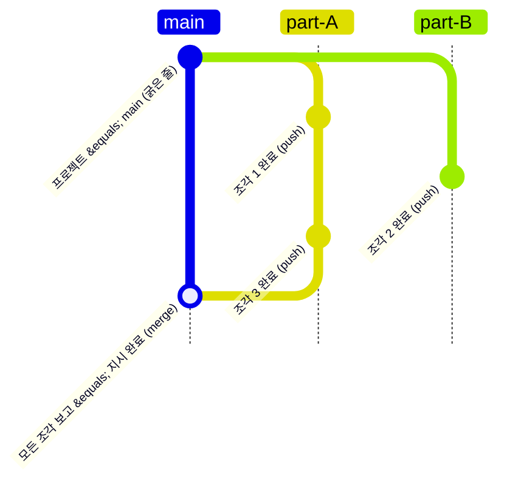

# AgentO Timeline 보기 설계 — 프로젝트의 기능 완료 타임라인

**대상 버전**: AgentO 1.0.0 (2026-10-21)
**관련 코드**: `src/renderer/src/lib/threads.ts` · `lib/progress.ts` · `components/TeamLog.tsx` · `components/Toolbar.tsx` · `store.ts`
**읽는 사람**: AgentO 를 이어서 개발하는 사람, 그리고 이 보기를 쓸 감독(사용자)

## 목차 

- [**1. 개요 — 프로젝트의 진행을 git log 처럼**](#cat-1) (3 항목)
- [**2. 데이터 — 점과 선을 무엇으로 만드나**](#cat-2) (4 항목)
- [**3. 화면 — 그래프, 상세, 조작**](#cat-3) (3 항목)
- [**4. 구현 계획**](#cat-4) (3 항목)
- [**5. 정할 것과 후속 과제**](#cat-5) (2 항목)

---

# 1 개요 — 프로젝트의 진행을 git log 처럼 

> 보기 모드에 「Timeline」을 추가한다. 프로젝트는 main 브랜치, 파트는 브랜치, 일 한 조각이 끝날 때마다 push 처럼 점이 찍히고, 감독 지시가 다 끝나면 main 으로 merge 된다. 점을 누르면 그 기능이 무엇이었는지 바로 보인다.

## 1.1 화면 그림 — 세로 시간축 · 레인 = 파트 · 점 = 완료된 일

지금 무엇이 어디까지 됐는지를 Logs(대화 순서)나 Ground(현재 상태)로는 한눈에 보기 어렵다. History 는 **시간에 따른 결과물**만 남긴 그래프다.

범례: **main** = 프로젝트 하나(굵은 줄) · **branch** = 파트 하나(레인) · **fork** = 감독 지시가 파트로 갈라짐 · **push** = 조각 완료 보고 하나 · **merge** = 모든 조각 보고(지시 완료) · 속 빈 점 = 진행 중. 위쪽이 최신이다.

*그림 — Sample-App 프로젝트의 History 예시. 아래가 과거, 위가 최신(git log --graph 와 같은 방향).*

## 1.2 git 과 AgentO 의 대응 — main · branch · push · merge 를 무엇으로 정하나

| git | AgentO | 데이터 출처 |
|---|---|---|
| 저장소 · **main** | 프로젝트 (top-level) | `projects` (parentId 없음) |
| **branch** | 파트 (part) | `projects.parentId` = 프로젝트, 파트 없는 세션은 main 레인 |
| **fork** (브랜치 시작점) | 감독 지시가 파트 세션으로 내려간 지점 | Logs 스레드의 directive (`buildThreads`) |
| **push** (commit) | 일 한 조각의 **완료 보고** | report (`pieceResult` = finished, `report_up`) |
| **merge** | 그 지시의 모든 조각이 보고됨 = 지시 완료 | `orderProgress` done = total, 또는 Done 표시 |
| commit hash | 보고에 적힌 커밋 해시 (`ef9f918`) | 보고 본문에서 추출 |
| 진행 중 브랜치 | 아직 보고가 없는 조각 | 지시는 있고 보고는 없음 (속 빈 점) |

## 1.3 목적과 범위 — Ground · Split · Tabs 다음 4번째 보기

- **목적**: 프로젝트마다 「무슨 기능이 언제, 어느 파트에서 끝났나」를 한 화면에서 본다. 점 하나 = 기능 하나.
- **보기 모드**: 툴바의 `Ground · Split · Tabs` 옆에 **Timeline** (`Ctrl+4`). 내부 id `timeline`.
- **토큰 0**: 이미 기록된 지시·보고(inbox)만 읽는다. 세션에 묻거나 요약을 만들지 않는다.
- **범위 밖**: 실제 git 저장소의 커밋 그래프를 그대로 보여 주는 것(2단계에서 보조로만 붙인다, 4.2).

---

# 2 데이터 — 점과 선을 무엇으로 만드나 

> 새 데이터는 만들지 않는다. Logs 탭이 쓰는 스레드(감독 지시 → 하위 지시 → 보고)를 레인 위의 점과 선으로 바꾼다.

## 2.1 노드 종류 — 지시 · 조각 · 완료 · 진행 중

- **Order (fork)** — `main 레인` — 감독의 지시(Manager 탭·루틴). Direct(세션 직접 입력)는 제외 — 대화일 뿐 일의 단위가 아니다
- **Piece (push)** — `파트 레인` — 선수·코치가 일을 끝내고 올린 보고 하나. 제목 = 보고 첫 줄, 해시가 있으면 태그
- **Merge** — `main 레인` — 그 지시의 조각이 전부 보고됨(또는 Done). 조각 수·끝난 시각
- **Open** — `파트 레인 · 속 빈 점` — 지시는 갔고 보고는 아직 — 지금 진행 중인 일

## 2.2 무엇을 「주요 기능」으로 보나 — 잡음은 빼고 결과만

| 넣는다 | 뺀다 | 이유 |
|---|---|---|
| 감독 지시 (Order) | Direct 입력, 상태 확인(Ask for status), 자동 Fresh start | 일의 단위가 아니라 대화·관리 |
| 선수의 `finished` 보고, `report_up` | 코치의 `replied`(일을 넘겼다는 답) | 넘긴 것은 결과가 아니다 — 결과는 선수의 보고로 찍힌다 |
| 결과 없이 멈춘 조각(`stopped`, error) | 같은 보고의 반복(같은 본문) | 멈춘 것은 빨간 점으로 남겨야 보인다 |

- 툴바 필터: **All / Pieces only / With commits** (해시가 있는 점만 — 「push 한 것만」).
- 같은 세션이 같은 지시 아래서 여러 번 보고하면 점을 여러 개 찍는다 (git 의 연속 commit).

## 2.3 레인 배정 — 파트 = 레인, 파트 없는 세션 = main

- 레인 순서 = 사이드바 트리의 파트 순서. 수석코치(Coach)·팀 Head Coach 의 보고는 main 레인에 찍는다.
- 세션이 나중에 다른 파트로 옮겨져도 **그 보고가 올라온 때의 파트**에 남는 게 맞지만, 지금 기록에는 당시 파트가 없다 → 1단계는 현재 파트 기준, 기록에 `projectId` 를 남기는 것은 후속 과제(5.2).
- 닫힌 프로젝트·삭제된 세션: 레인은 남기고 점은 회색(이력이므로).

## 2.4 커밋 해시 추출 — 보고 본문에서

- 보고 본문의 `커밋 ef9f918`, `` `0cc6338b7` ``, `commit abc1234` 처럼 **커밋 맥락**에 붙은 7~12자리 16진수만 뽑는다(일반 숫자·색상코드 제외).
- 점의 태그로 보이고, 누르면 복사. 2단계에서 저장소를 알면 `git show` 요약(파일 수·+/-)을 붙인다.

---

# 3 화면 — 그래프, 상세, 조작 

> 왼쪽은 레인 그래프, 점을 누르면 오른쪽 패널에 그 기능의 상세가 열린다.

## 3.1 레이아웃 — 프로젝트별 그래프 · 세로 시간축

- **상단 바**: 프로젝트 칩(Manager·Inbox·Logs 와 같은 공유 필터, 여러 개면 프로젝트별 그래프를 위아래로), 기간(7일 · 30일 · 전체), 검색, 필터(2.2).
- **그래프**: 한 행 = 점 하나(시간순, 최신 위). 왼쪽부터 main 레인, 파트 레인들. 행 오른쪽에 제목(보고 첫 줄) · 세션 · 시각 · 해시 태그.
- **선**: fork = main 의 지시 점에서 파트 레인으로 내려가는 곡선, merge = 마지막 조각에서 main 으로 돌아오는 곡선. 진행 중 조각은 점선.
- 색: main = 프로젝트 색, 파트 레인 = 프로젝트 색의 옅은 단계(같은 프로젝트임을 유지), 지시 = Manager 색, merge = 완료 색.

## 3.2 점을 누르면 — 오른쪽 패널 「History」 상세

| 점 | 상세에 보이는 것 | 버튼 |
|---|---|---|
| Order | 지시 전문, 진행률(조각 n/m), 받은 세션들 | Flow (기존 흐름도), Logs 에서 보기 |
| Piece | 보고 전문(서식), 해시·파일 링크(클릭해 열기), 보고한 세션 · 파트 · 시각 | 세션 열기, 같은 레인 이전·다음 |
| Merge | 조각 목록(각 조각 제목 · 세션), 걸린 시간 | — |
| Open | 받은 지시, 지금 하는 일(실행 중 도구 → 마지막 문장) | 세션 열기, Ask for status |

## 3.3 조작 — 키보드 · 접기

- ↑ ↓ 로 점 이동, Enter = 상세, `C` = 해시 복사.
- 지시 점을 접으면 그 지시의 조각들이 한 줄로 묶인다(긴 프로젝트에서 「주요 기능만」 보기).
- 그래프는 보이는 행만 그린다(수천 개 보고도 가볍게).

---

# 4 구현 계획 

> 1단계는 렌더러만으로 끝난다(데몬 재시작 없음). 실제 git 정보는 2단계에서 보조로 붙인다.

## 4.1 1단계 — 기록 기반 그래프 — 렌더러만 · 토큰 0

| 파일 | 내용 |
|---|---|
| `store.ts` | `ViewMode` 에 `'history'`, 툴바·메뉴·`Ctrl+4` |
| `lib/history.ts` (새) | 스레드 → 레인·행 계산(`buildHistory`), 해시 추출, 필터 — 순수 함수, 상태당 한 번 계산(`lib/closed.ts` 캐시 방식) |
| `components/HistoryView.tsx` (새) | 상단 바 + SVG 레인 + 행 목록(가상 스크롤) |
| `components/RightPanel.tsx` | 선택한 점의 상세(3.2) — 기존 `OrderCard`·`inboxHtml`·`OrderProgress` 재사용 |

## 4.2 2단계 — 실제 git 붙이기 — 데몬 `git.log` · 선택

- 데몬에 `git.show {repo, hash}` (파일 수·+/-·메시지) — 해시 태그를 누르면 요약.
- 파트 폴더가 git 저장소면 `git log --since` 로 보고에 없는 커밋도 회색 점으로 보이게 하는 옵션.
- 저장소 판단은 파트·프로젝트 폴더의 `.git` 유무.

## 4.3 성능 —

- `buildHistory` 는 inbox·sessions·projects 가 바뀔 때만, 프로젝트별로 다시 계산. 상태 바뀔 때마다 그래프 전체를 다시 그리지 않도록 행 컴포넌트는 `memo`.
- SVG 는 보이는 범위의 행만 그린다(행 높이 고정 → 위치 계산이 단순).

---

# 5 정할 것과 후속 과제 

> 아래 세 가지는 만들기 전에 정해야 한다.

## 5.1 결정 필요 — 사용자 선택

| 질문 | 결정 (2026-10-21) | 버린 안 |
|---|---|---|
| 점의 단위 | **기능 완료** — 한 조각(지시)에 보고·커밋이 여러 번이어도 최종 완료 보고 하나가 점 하나 | 보고(push) 하나마다 점 · 실제 git 커밋만 |
| 이름 | **Timeline** | History · Graph |
| 위치 | 가운데 화면(기능 이름에 폭이 필요)이되, 툴바에서 세션 배치(Ground·Split·Tabs)와 **구분선으로 나눈 별도 버튼** — 성질이 다름(세션 보기가 아니라 Logs 같은 기록 보기). Timeline 에서는 Auto Arrange·Fit All·Focus 숨김 (2026-10-23) | 오른쪽 패널 탭(폭 부족) · 세션 보기와 한 묶음 |
| 모양 | git 그래프를 엄격히 따르지 않음 — 날짜 줄 + 파트 레인 + 점, 읽기 쉬운 타임라인이 우선 | git log --graph 그대로 |
| 직접 입력(Direct) | 일을 시킨 직접 입력은 포함, 짧은 질문(물음표로 끝나는 80자 미만)은 제외 | Direct 전부 제외 |
| 조각이 하나뿐인 지시 | 기능 점 한 줄(제목 = 감독이 쓴 말, 한 단어 답이면 보고 첫 줄) | 지시·기능·완료 세 줄 |

## 5.2 후속 과제 —

- 보고 기록(inbox)에 당시 `projectId` 를 남겨, 세션이 파트를 옮겨도 점이 원래 레인에 남게 한다(데몬).
- 보고 제목을 더 짧게 — 지금은 첫 줄. 선수 지침에 「보고 첫 줄은 기능 이름 한 줄」을 넣으면 그래프가 깔끔해진다(토큰 0).
- 마일스톤(태그): 감독이 점에 이름을 붙이는 기능(`v0.3 시연판`).

---
