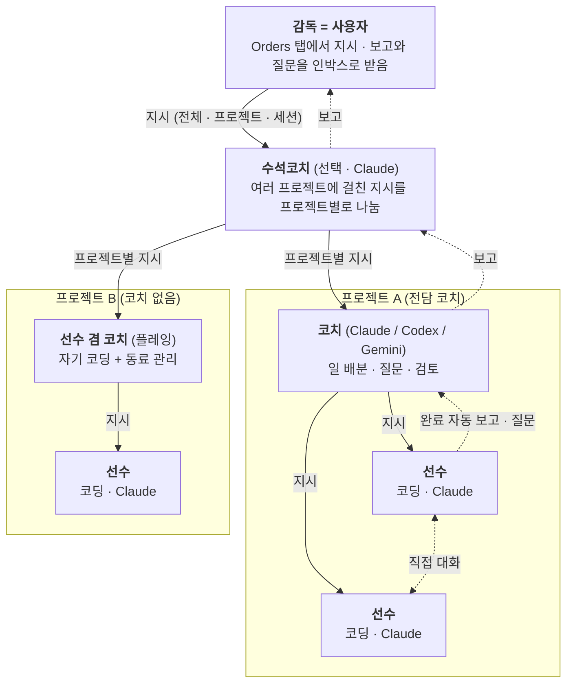

# AgentO 팀 계층 설계 — 감독·코치·선수

**대상 버전**: AgentO 0.1.0 (2026-10-01)  
**관련 코드**: `src/daemon/team.ts` · `src/daemon/sessions.ts` · `src/daemon/store.ts` · `src/shared/protocol.ts` · `src/renderer/src/components/RightPanel.tsx`  
**읽는 사람**: AgentO 를 이어서 개발하는 사람 (데몬·렌더러 구조를 안다고 가정)

> 세션끼리 주고받는 지시와 보고는 사용자 승인 없이 바로 입력된다. 기록은 Orders 탭에 남지만 되돌릴 수는 없다.

<a id="toc"></a>

## 목차 

- [**1. 개요 — 사용자가 감독, 세션들이 알아서 협업한다**](#cat-1) (2 항목)
- [**2. 역할 정의**](#cat-2) (4 항목)
- [**3. 협업 흐름**](#cat-3) (4 항목)
- [**4. 연결 구조 — 세션이 다른 세션에 닿는 경로**](#cat-4) (3 항목)
- [**5. MCP 도구와 권한**](#cat-5) (2 항목)
- [**6. 데이터·프로토콜·UI 변경**](#cat-6) (3 항목)
- [**7. 제약과 후속 과제**](#cat-7) (2 항목)
- [📎 **부록**](#appendix) — A.1 변경 파일 목록

---

<a id="cat-1"></a>

# 1 개요 — 사용자가 감독, 세션들이 알아서 협업한다 

> 사용자가 감독이 되어 Orders 탭에서 지시를 내리면, 수석코치·코치·선수 세션이 일을 나누고, 끝나면 서로에게 자동으로 보고하며 협업한다. 코딩은 모두 Claude 선수가 맡는다.

## 1.1 팀 구성도 — 감독(사용자) · 수석코치 0~1 · 프로젝트당 코치 0~1 · 선수 N

프로젝트는 축구팀의 포지션(공격·미드필드·수비·골키퍼)에 해당한다. 지시는 위에서 아래로 내려가고, 보고는 지시를 내린 쪽으로 자동으로 거슬러 올라온다.



| 역할 | 개수 | 에이전트 | 하는 일 | 지시받는 곳 |
|---|---|---|---|---|
| 감독 | 사용자 1명 | — | Orders 탭에서 지시, 보고·질문 확인 | — |
| 수석코치 | 0~1 (선택) | Claude 고정 | 여러 프로젝트에 걸친 지시를 나눠 코치에게 넘김 | 감독 |
| 코치 | 프로젝트당 0~1 (선택) | 전담: Claude · ChatGPT(Codex CLI) · Gemini(Gemini CLI) / 플레잉: 선수 그대로 | 일 배분, 질문, 검토, 보고 | 감독 또는 수석코치 |
| 선수 | N | Claude (코딩은 모두 Claude) | 코드·문서·테스트 작업, 동료와 조율 | 코치, 코치가 없으면 감독·수석코치 |

## 1.2 설계 결정 — 사용자 선택 · 2026-10-01

<table>
<thead><tr><th style="white-space:nowrap">결정</th><th style="white-space:nowrap">채택안</th><th style="white-space:nowrap">버린 안</th><th style="white-space:nowrap">이유</th></tr></thead>
<tbody>
<tr style="background:#f8f9fa"><td><b>감독</b></td><td>사용자 본인. AI 세션은 수석코치(선택)</td><td>AI 감독 세션이 항상 존재</td><td>최종 목적이 「내가 지시하면 팀이 알아서 움직이는 것」이다</td></tr>
<tr style="background:#ffffff"><td><b>관리 방식</b></td><td>MCP 도구로 실제 조작</td><td>UI 계층 표시만</td><td>세션이 직접 조회·지시해야 협업이 된다</td></tr>
<tr style="background:#f8f9fa"><td><b>지시 승인</b></td><td>바로 전송 + 기록</td><td>사용자 승인 후 전송 · 읽기 전용</td><td>사람이 매번 승인하면 위임 효과가 없다</td></tr>
<tr style="background:#ffffff"><td><b>협업 연결</b></td><td>완료 자동 보고 · 선수 질문 · 선수끼리 대화</td><td>코치가 대기 도구로 붙잡고 기다리기만</td><td>끝난 쪽이 먼저 알려야 다음 일이 이어진다</td></tr>
<tr style="background:#f8f9fa"><td><b>에이전트 배치</b></td><td>수석코치·선수 Claude 고정, 전담 코치만 Claude·ChatGPT·Gemini 선택</td><td>전부 Claude 통일 · 역할 무관 자유 선택</td><td>코딩과 지휘는 대화 기록·상태 추적이 되는 Claude 에 두고, 질문·검토 자리에서만 다른 관점과 구독 사용량 분산을 얻는다</td></tr>
<tr style="background:#ffffff"><td><b>코치 없는 프로젝트</b></td><td>선수를 플레잉 코치로 지정, 없으면 첫 선수가 리더</td><td>코치가 없으면 지시 불가</td><td>작은 프로젝트에 코치 세션을 따로 두지 않아도 된다</td></tr>
</tbody>
</table>

---

<a id="cat-2"></a>

# 2 역할 정의 

> 세션의 역할은 `Session.role`(`head` · `coach` · `player`) 하나로 구분한다. 감독은 세션이 아니라 사용자다.

## 2.1 감독 — 사용자 — Orders 탭 · 인박스

### 2.1.1 지시 넣기

감독은 세션이 아니지만 프로젝트 트리 맨 위에 항상 「Manager (You)」 행으로 보이고, 누르면 Orders 탭이 열린다. 오른쪽 패널 Orders 탭(툴바 Orders 버튼, 패널 분리 중이면 패널 창)에서 대상을 고르고 지시를 쓴 뒤 Give Order(Ctrl+Enter)를 누른다. 데몬은 `team.order` 를 받아 대상에 따라 받는 세션을 정한다.

| 대상 | 받는 세션 |
|---|---|
| 전체 | 수석코치. 없으면 프로젝트마다 리더(코치, 없으면 첫 선수) |
| 프로젝트 | 그 프로젝트의 코치(전담 또는 플레잉), 없으면 가장 먼저 만든 선수 |
| 세션 | 고른 세션 |

리더가 선수이면 지시 끝에 「동료와 나눠 처리하라」는 안내를 붙인다. 지시는 `[Order from the manager (the user)]` 머리말과 함께 들어간다.

### 2.1.2 보고 받기

Orders 탭 아래 Team Feed 에 지시·위임·보고가 시간순으로 쌓인다. 사용자에게 온 것(지시받은 세션의 응답, `report_up` 으로 사용자에게 올린 보고·질문)은 읽지 않음 상태로 인박스에도 들어가 배지가 켜진다. 세션끼리 주고받은 기록은 Team Feed 에만 보인다.

## 2.2 수석코치 — role = 'head' · 0~1개 · Claude

| 속성 | 값 |
|---|---|
| 만들기 | 프로젝트 트리 맨 위 「+ Head Coach」 행 → `head.create` (하나만 허용) |
| `projectId` / `folderId` | 둘 다 `''` — 어느 프로젝트에도 속하지 않는다 |
| 작업 폴더 | `%APPDATA%\AgentO\team\head-coach` |
| 지침 파일 | `CLAUDE.md` (6.2 의 재생성 규칙) |
| 데몬 재시작 | 꺼져 있으면 `resumeHead()` 가 이전 대화를 이어 다시 띄운다 |
| 삭제 | 일반 세션처럼 삭제 가능 |

## 2.3 코치 — 전담 코치와 플레잉 코치 — role = 'coach' · 프로젝트당 0~1개

### 2.3.1 두 종류의 코치

<table>
<thead><tr><th style="white-space:nowrap">구분</th><th style="white-space:nowrap">전담 코치</th><th style="white-space:nowrap">플레잉 코치</th></tr></thead>
<tbody>
<tr style="background:#f8f9fa"><td><b>만들기</b></td><td>프로젝트 행의 ⚑ 버튼 → 「Coach runs on」에서 Claude Code · Codex · Gemini CLI 선택 → <code>coach.create</code></td><td>선수 카드 메뉴 「Make Playing Coach」 → <code>session.setRole</code></td></tr>
<tr style="background:#ffffff"><td><b>작업 폴더</b></td><td><code>team\coach-&lt;projectId&gt;</code> (<code>folderId = ''</code>)</td><td>자기 프로젝트 폴더 그대로 (<code>folderId</code> 유지)</td></tr>
<tr style="background:#f8f9fa"><td><b>코딩</b></td><td>하지 않는다. 프로젝트 폴더는 읽기만 (Claude <code>--add-dir</code>, Gemini <code>--include-directories</code>)</td><td>자기 작업을 계속한다</td></tr>
<tr style="background:#ffffff"><td><b>지침</b></td><td>폴더의 <code>CLAUDE.md</code>·<code>AGENTS.md</code>·<code>GEMINI.md</code></td><td>역할이 바뀔 때 세션에 붙여 넣는 안내문 + MCP 서버 안내</td></tr>
<tr style="background:#f8f9fa"><td><b>되돌리기</b></td><td>삭제</td><td>카드 메뉴 「Back to Player」</td></tr>
</tbody>
</table>

### 2.3.2 제약

데몬은 이미 코치가 있는 프로젝트에 두 번째 코치를 만들거나 지정하지 않는다. 전담 코치는 선수로 바꿀 수 없다. 해당 CLI 가 설치되어 있지 않으면 전담 코치는 「Command not found」 오류 상태로 만들어지고, 설치·로그인 뒤 Restart 하면 뜬다. 역할 변경은 다시 시작하지 않아도 바로 적용된다(5.1).

## 2.4 선수 — role = 'player' · 기본값 · Claude

지금까지의 일반 세션이 선수다. 선수도 MCP 도구를 받아 코치에게 묻고(`report_up`), 같은 프로젝트 동료의 대화를 읽고 말을 건다(`read_session`·`send_to_session`). 지침은 사용자 프로젝트 폴더에 파일을 만들지 않고 MCP 서버의 안내문(`initialize` 의 `instructions`)으로 전한다. **코딩은 모두 Claude 가 맡는다** — `create_session` 은 에이전트를 고르는 인자가 없고 항상 Claude Code 선수를 만든다. MCP 연결은 기동할 때 붙으므로, 이 기능 이전에 띄운 선수는 다시 시작해야 도구가 생긴다.

---

<a id="cat-3"></a>

# 3 협업 흐름 

> 세션 사이의 메시지는 데몬의 전달 대기열을 거친다. 지시를 받은 세션이 일을 끝내면 데몬이 그 결과를 지시한 쪽에 자동으로 넣어 주므로, 누구도 기다리며 붙잡고 있을 필요가 없다.

## 3.1 지시 한 번의 흐름 — 테스트에서 실제로 일어난 순서

사용자가 Orders 탭에서 TestProj 에 「선수에게 PONG2 라고 답하게 하고, 답을 받으면 report_up 으로 알려 달라」고 지시했을 때의 Team Feed 순서다.

| 순서 | 일 | Team Feed 기록 |
|---|---|---|
| 1 | 데몬이 지시를 TestProj 코치에게 전달 | `Manager (you) → Coach · TestProj: …` |
| 2 | 코치가 `send_to_session` 으로 선수에게 위임 | `Coach · TestProj → Claude Code · proj: Reply with exactly the word PONG2…` |
| 3 | 코치의 차례가 끝남 → 사용자에게 「응답」 보고 | `Coach · TestProj replied: I've asked the player…` |
| 4 | 선수가 답하고 차례를 끝냄 → 데몬이 코치에게 결과를 넣음 | `Claude Code · proj → Coach · TestProj: finished: PONG2` |
| 5 | 코치가 `report_up` → 마지막으로 지시한 사용자에게 | `Coach · TestProj → Manager (you): Player replied: PONG2` |

지시부터 마지막 보고까지 사람의 개입은 처음 지시 한 번뿐이었다(코치 폴더의 신뢰 확인은 처음 한 번 수락).

## 3.2 전달 대기열 — Team.enqueue · Team.flush

모든 세션 간 메시지와 사용자 지시는 대상별 대기열에 들어가고, 1.5초마다(그리고 대상이 waiting 이 될 때마다) 아래 조건을 보고 전달한다. 쌓인 메시지는 빈 줄로 이어 한 번의 bracketed paste(`ESC[200~ … ESC[201~`)로 넣고 Enter 를 누른다 — 메시지 안 줄바꿈에서 중간 제출되지 않게 하기 위해서다.

| 대상 상태 | 처리 |
|---|---|
| 꺼져 있음 (휴면·완료·오류) | 다시 띄운다(`resume`). 한 번만 시도 |
| 작업 중 (`working`·`starting`) | 그대로 둔다 |
| 직전 지시를 넣은 지 20초 안이고 아직 작업을 시작하지 않음 | 그대로 둔다 (지시가 겹치지 않게) |
| 권한·신뢰·선택 프롬프트가 떠 있음 | 붙여 넣지 않는다. 사용자 인박스에 「프롬프트에 답해 달라」를 한 번 올린다 |
| 그 외 waiting | 전달 |

## 3.3 완료 자동 보고와 report_up 경로 — Team.complete · director

### 3.3.1 「끝났다」 판정

지시가 전달되면 그 대상을 「지시 처리 중」으로 표시한다. 상태가 working 이 된 뒤 waiting 으로 돌아와 **4초 동안 유지**되면 끝난 것으로 본다(상태는 출력이 2.5초 멈추면 waiting 이 되는 추정값이라 짧은 멈춤을 걸러 낸다). 프로세스가 종료되면 바로 끝난 것으로 본다. 20초 안에 작업을 시작하지 않은 지시는 처리 중 표시를 지운다.

### 3.3.2 보고 내용과 받는 곳

끝나면 대상의 마지막 답(Claude 는 대화 기록의 마지막 사용자 메시지 이후 답변, 그 외는 터미널 끝 1000자, 최대 1500자)을 붙여 보고한다. 선수는 「finished」, 코치·수석코치는 차례를 마친 것이므로 「replied」로 표기한다.

| 지시한 쪽 | 보고 |
|---|---|
| 사용자 | 인박스에 읽지 않음으로 (Team Feed 에도 보임) |
| 세션 | 그 세션의 대기열에 `[AgentO] "…" finished the task you sent. Its last reply: …` |

### 3.3.3 report_up 이 가는 곳

세션마다 **마지막으로 지시를 넣은 쪽**(`director`)을 기억한다. `report_up` 은 그곳으로 간다 — 사용자가 지시했으면 사용자 인박스로. 기억이 없으면 역할 순서로 올라간다: 선수 → 코치 → 수석코치 → 사용자.

## 3.4 안전장치 — 프롬프트 감지 · 보내기 횟수 제한 · 알림 정리

### 3.4.1 프롬프트 감지는 마지막 입력 이후 출력으로

`SessionManager` 는 세션마다 **마지막 입력 이후의 출력**(최대 8KB)을 따로 모은다. 입력(`input`·`paste`)이 들어가면 비운다. 이 출력의 끝 1500자에 신뢰 확인·권한 확인·「Enter to confirm」 같은 문구가 있으면 아직 답하지 않은 프롬프트로 본다. 전체 로그 끝을 보면 안 된다 — TUI 가 화면을 다시 그려도 로그에는 이전 프롬프트 문구가 남아, 수락한 뒤에도 계속 걸린 것으로 오판한다(테스트에서 실제로 발생).

### 3.4.2 보내기 횟수 제한

세션이 10분 동안 보낼 수 있는 메시지 수를 제한한다: 선수 12개, 코치·수석코치 60개. 넘으면 도구가 「그만 보내고 자기 일을 하거나 report_up 하라」는 오류를 돌려준다. 선수끼리 대화를 허용했기 때문에 두 세션이 끝없이 주고받는 것을 막는 장치다.

### 3.4.3 대기 알림 정리

팀 작업 중의 waiting 은 정상 대기라 「waiting for input」 인박스 알림을 만들지 않는다(`SessionManager.quietWaiting`): 수석코치·코치, 지시를 처리 중인 선수, 대기열에 메시지가 있는 세션. 사람에게 필요한 질문은 `report_up` 으로 따로 온다.

---

<a id="cat-4"></a>

# 4 연결 구조 — 세션이 다른 세션에 닿는 경로 

> 데몬이 기존 WebSocket 포트에 HTTP MCP 엔드포인트를 함께 연다. 각 세션의 CLI 는 기동할 때 받은 설정으로 이 엔드포인트에 붙는다.

## 4.1 호출 경로 — CLI → MCP → Team → 대기열 → 대상 PTY

- **세션 CLIclaude · codex · gemini도구 호출 (서버 이름 agento)** — `claude · codex · gemini` — 도구 호출 (서버 이름 agento)
- **데몬 HTTPPOST /mcp/&lt;sessionId&gt;ws 서버와 같은 포트 · JSON-RPC** — `POST /mcp/&lt;sessionId&gt;` — ws 서버와 같은 포트 · JSON-RPC
- **Teamteam.ts호출자 식별 · 역할·범위 검사 · 도구 실행** — `team.ts` — 호출자 식별 · 역할·범위 검사 · 도구 실행
- **전달 대기열enqueue · flush대상이 쉴 때 전달 · 완료 추적** — `enqueue · flush` — 대상이 쉴 때 전달 · 완료 추적
- **대상 PTYSessionManager.paste사용자 입력과 같은 경로** — `SessionManager.paste` — 사용자 입력과 같은 경로

| 단계 | 구성 요소 | 하는 일 |
|---|---|---|
| 1 | 세션 CLI | 지침에 따라 `agento` 서버의 도구를 호출한다 |
| 2 | 데몬 HTTP | 토큰을 확인하고 주소에서 호출 세션을 찾는다 |
| 3 | `Team` | 호출자의 현재 역할로 권한·범위를 검사하고 도구를 실행한다 |
| 4 | 전달 대기열 | 메시지를 대상이 쉴 때 넣고, 지시면 완료를 추적한다 |
| 5 | 대상 PTY | 붙여 넣은 입력을 사용자 입력처럼 받는다 |

사용자 지시는 1·2 대신 WebSocket `team.order` 로 들어와 4 부터 같은 길을 간다.

## 4.2 에이전트별 MCP 연결 — launchExtras · launchEnv

### 4.2.1 공통 — 주소와 인증

엔드포인트 주소에 세션 id 를 넣는다: `http://127.0.0.1:<port>/mcp/<sessionId>`. 인증은 데몬 토큰을 `Authorization: Bearer` 로 보낸다. 포트와 토큰은 데몬이 재시작할 때마다 바뀌므로 **기동할 때마다** 설정을 다시 만든다. `SessionManager` 는 기동 인자에 `launchExtras(s)` 를, 환경 변수에 `launchEnv(s)` 를 덧붙인다.

### 4.2.2 에이전트별 방식

<table>
<thead><tr><th style="white-space:nowrap">에이전트</th><th style="white-space:nowrap">적용 역할</th><th style="white-space:nowrap">설정 위치</th><th style="white-space:nowrap">토큰</th><th style="white-space:nowrap">도구 승인</th><th style="white-space:nowrap">도구 제한 시간</th></tr></thead>
<tbody>
<tr style="background:#f8f9fa"><td><b>Claude</b></td><td>전부</td><td><code>team\mcp\&lt;id&gt;.json</code> 을 <code>--mcp-config</code> 로</td><td>파일의 <code>headers</code></td><td><code>--allowedTools mcp__agento</code></td><td>기본값</td></tr>
<tr style="background:#ffffff"><td><b>Codex</b></td><td>전부</td><td>기동 인자 <code>-c mcp_servers.agento.…</code> 다섯 개</td><td>환경 변수 <code>AGENTO_MCP_TOKEN</code></td><td><code>default_tools_approval_mode=auto</code></td><td><code>tool_timeout_sec=660</code></td></tr>
<tr style="background:#f8f9fa"><td><b>Gemini</b></td><td>전담 코치만</td><td>코치 폴더의 <code>.gemini\settings.json</code> (다른 설정 보존)</td><td>파일의 <code>headers</code></td><td><code>trust: true</code></td><td><code>timeout: 660000</code> ms</td></tr>
</tbody>
</table>

Gemini 설정 파일은 작업 폴더에 생기므로, 사용자 프로젝트 폴더에서 도는 선수·플레잉 코치에게는 붙이지 않는다. 도구 제한 시간은 `wait_for_sessions` 의 최대 600초보다 길게 잡는다(Codex 기본값 60초).

### 4.2.3 Codex 인자에 따옴표·공백을 쓰지 않는 이유

Windows 에서 Codex 는 npm 의 `codex.cmd` 를 거쳐 실행되어, 따옴표와 공백이 든 인자는 명령줄을 넘기며 깨지기 쉽다. 그래서 `-c` 값을 따옴표 없이 쓴다(Codex 는 TOML 로 읽지 못한 값을 문자열로 받는다). 세션 id 는 주소에 넣고, 공백이 든 `Bearer …` 는 환경 변수로 넘긴다.

```text
-c mcp_servers.agento.url=http://127.0.0.1:<port>/mcp/<sessionId>
-c mcp_servers.agento.bearer_token_env_var=AGENTO_MCP_TOKEN
-c mcp_servers.agento.default_tools_approval_mode=auto
-c mcp_servers.agento.tool_timeout_sec=660
-c mcp_servers.agento.startup_timeout_sec=20
```

### 4.2.4 Claude 인자 순서

`--add-dir`·`--mcp-config`·`--allowedTools` 는 값을 여러 개 받는 옵션이라, 새 선수의 첫 프롬프트 같은 위치 인자는 **그 앞에** 둔다.

## 4.3 HTTP 엔드포인트 규칙 — Streamable HTTP · JSON 응답만

| 요청 | 응답 |
|---|---|
| `Authorization` 토큰 불일치 | 401 |
| 주소의 세션 id(또는 `X-AgentO-Session` 헤더)가 없는 세션 | 403 |
| `POST` + 요청(id 있음) | 200, `application/json` (배치면 배열) |
| `POST` + 알림만(id 없음) | 202, 본문 없음 |
| `GET` | 405 — 서버에서 먼저 보내는 스트림은 없다 |
| `DELETE` | 200 — 할 일 없음 |
| 본문 1MB 초과 | 연결 종료 |

지원 메서드는 `initialize`·`ping`·`tools/list`·`tools/call` 이다. `initialize` 는 클라이언트의 `protocolVersion` 을 그대로 돌려주고 호출자 역할에 맞는 안내문을 `instructions` 로 준다. 도구 실행 오류는 JSON-RPC 오류가 아니라 `isError: true` 결과로 돌려줘 세션이 읽고 대응하게 한다.

---

<a id="cat-5"></a>

# 5 MCP 도구와 권한 

> 도구 목록은 역할과 상관없이 모두에게 같게 보이고, 권한은 호출할 때 호출자의 현재 역할로 검사한다. 그래서 선수를 플레잉 코치로 바꿔도 다시 시작할 필요가 없다.

## 5.1 도구 목록 — MCP 서버 이름 agento · 9개

<table>
<thead><tr><th style="white-space:nowrap">분류</th><th style="white-space:nowrap">도구</th><th style="white-space:nowrap">수석코치</th><th style="white-space:nowrap">코치</th><th style="white-space:nowrap">선수</th><th style="white-space:nowrap">하는 일</th></tr></thead>
<tbody>
<tr style="background:#f8f9fa"><td rowspan="3" valign="top"><b>조회</b></td><td><code>list_projects</code></td><td>✓</td><td>—</td><td>—</td><td>프로젝트별 폴더, 코치 세션 id, 선수 수</td></tr>
<tr style="background:#f8f9fa"><td><code>list_sessions</code></td><td>✓</td><td>✓</td><td>✓</td><td>범위 안 세션의 역할·프로젝트·상태</td></tr>
<tr style="background:#f8f9fa"><td><code>read_session</code></td><td>✓</td><td>✓</td><td>✓</td><td>Claude 는 대화 기록(기본 20건, 최대 200), 그 외는 터미널 끝 6000자</td></tr>
<tr style="background:#ffffff"><td rowspan="3" valign="top"><b>소통</b></td><td><code>send_to_session</code></td><td>✓</td><td>✓</td><td>✓</td><td>대기열로 전달. 기본은 지시(끝나면 자동 보고), <code>directive=false</code> 면 단순 답변</td></tr>
<tr style="background:#ffffff"><td><code>report_up</code></td><td>✓</td><td>✓</td><td>✓</td><td>마지막으로 지시한 쪽에 보고·질문 (3.3.3)</td></tr>
<tr style="background:#ffffff"><td><code>wait_for_sessions</code></td><td>✓</td><td>✓</td><td>✓</td><td>대상이 쉴 때까지 대기 (기본 120초, 최대 600초). 자동 보고가 있어 보통은 필요 없음</td></tr>
<tr style="background:#f8f9fa"><td rowspan="4" valign="top"><b>운영</b></td><td><code>create_session</code></td><td>✓</td><td>✓</td><td>—</td><td>프로젝트 폴더에 Claude 선수 생성, 첫 프롬프트를 주면 지시로 추적. 코치는 자기 프로젝트만</td></tr>
<tr style="background:#f8f9fa"><td><code>interrupt_session</code></td><td>✓</td><td>✓</td><td>—</td><td>작업 중단 — Claude 는 Esc, 그 외는 Ctrl+C</td></tr>
<tr style="background:#f8f9fa"><td><code>resume_session</code></td><td>✓</td><td>✓</td><td>—</td><td>꺼진 세션을 다시 띄우고 입력 대기까지 최대 30초 기다림</td></tr>
<tr style="background:#f8f9fa"><td><code>create_project</code></td><td>✓ 팀 전체 수석코치만</td><td>—</td><td>—</td><td>프로젝트 없이 내린 지시가 기존 프로젝트에 맞지 않을 때 새 프로젝트(폴더·수석코치) 생성, brief 를 첫 지시로 전달 (Orders › New project 와 같은 경로)</td></tr>
</tbody>
</table>

권한 없는 도구를 부르면 「not available to a player. Ask your coach with report_up」처럼 다음 행동을 알려 주는 오류를 돌려준다. 플레잉 코치는 역할이 `coach` 라 코치 칸을 따른다.

## 5.2 범위 규칙 — Team.inScope

호출한 세션을 기준으로 대상 세션이 범위 안인지 판단한다. 자기 자신은 대상이 될 수 없다. 범위 밖이면 「outside your scope」 오류를 돌려준다.

<table>
<thead><tr><th style="white-space:nowrap">호출자 ＼ 대상</th><th style="white-space:nowrap">수석코치</th><th style="white-space:nowrap">같은 프로젝트 코치·선수</th><th style="white-space:nowrap">다른 프로젝트 코치·선수</th></tr></thead>
<tbody>
<tr><td style="border-left:4px solid #1a4d8f;background:#e7f0ff"><b>수석코치</b></td><td style="background:#fafbfc;color:#adb5bd">자기 자신 — 불가</td><td style="background:#e7f7ec;color:#1a7f37;font-weight:700">가능</td><td style="background:#e7f7ec;color:#1a7f37;font-weight:700">가능</td></tr>
<tr><td style="border-left:4px solid #cf7700;background:#fff4e0"><b>코치</b></td><td style="background:#e7f7ec;color:#1a7f37;font-weight:700">가능</td><td style="background:#e7f7ec;color:#1a7f37;font-weight:700">가능</td><td style="background:#fdecec;color:#c0392b;font-weight:700">불가</td></tr>
<tr><td style="border-left:4px solid #1a7f37;background:#e7f7ec"><b>선수</b></td><td style="background:#fff4e0;color:#cf7700;font-weight:700">프로젝트에 코치가 없을 때만</td><td style="background:#e7f7ec;color:#1a7f37;font-weight:700">가능 (동료·코치)</td><td style="background:#fdecec;color:#c0392b;font-weight:700">불가</td></tr>
</tbody>
</table>

---

<a id="cat-6"></a>

# 6 데이터·프로토콜·UI 변경 

> 클라이언트와 데몬이 같이 보는 타입, DB, 지침 파일, 화면 표시가 바뀌었다.

## 6.1 프로토콜 — src/shared/protocol.ts

| 변경 | 내용 |
|---|---|
| `SessionRole` | `'head' \| 'coach' \| 'player'` |
| `Session.role` | 필수 필드. 수석코치는 `projectId = ''`, 수석코치·전담 코치는 `folderId = ''` |
| `TeamOrderTarget` | `{ kind: 'all' }` · `{ kind: 'project'; projectId }` · `{ kind: 'projects'; projectIds }`(여러 프로젝트에 같은 지시, 각 수신자에게 다른 수신 프로젝트를 알림) · `{ kind: 'session'; sessionId }` |
| `InboxItem.kind` | `'directive'`(지시·위임) · `'report'`(보고·질문·완료) 추가 |
| `InboxItem.fromId` | 지시·보고를 보낸 세션 id 또는 `'user'` — Ground 연결선의 근거 |
| `ClientMessage` | `head.create` · `coach.create { projectId, agent? }` · `session.setRole { id, role }` · `team.order { target, text }` |

## 6.2 DB 마이그레이션과 지침 파일 — Store.migrate() · writeInstructions()

### 6.2.1 DB

`sessions` 에 `role TEXT NOT NULL DEFAULT 'player'` 컬럼이, `inbox` 에 `from_id TEXT` 컬럼이 없으면 추가한다. 이전 설계의 AI 감독(`role = 'manager'`)은 `head` 로 바꾸고, 제목이 `Manager` 이면 `Head Coach` 로 바꾼다. `addInbox` 는 `read` 인자를 받아 세션 간 기록을 읽음 상태로 넣는다.

### 6.2.2 지침 파일 재생성 규칙

수석코치·전담 코치 폴더의 지침 파일은 첫 줄에 `<!-- agento:generated — delete this line to keep your own edits -->` 표시를 단다. 기동할 때마다 이 표시가 있으면 최신 내용으로 다시 쓰고, 사용자가 표시 줄을 지우면 손대지 않는다. 표시가 생기기 전의 파일(`# Role: Manager`·`# Role: Coach` 로 시작)도 다시 쓴다.

## 6.3 화면 표시 — 트리 · 카드 · Orders · 인박스

| 위치 | 표시 |
|---|---|
| 프로젝트 트리 | 맨 위에 항상 「Manager (You)」 행(클릭하면 Orders 탭), 그 아래 수석코치 행, 없으면 「+ Head Coach」. 프로젝트 안은 코치 먼저. 이름 옆 HEAD COACH · COACH · PLAYING COACH 태그. 코치 없는 프로젝트 행에 ⚑ 버튼 |
| Ground (보드) | 세션 카드가 모이는 축구장. 주고받은 쌍 사이에 곡선 연결선, 90초 안에 오간 쌍은 보낸 쪽 → 받는 쪽으로 흐르는 점선과 화살표 (지시 파랑, 보고 분홍) |
| 프로젝트 그룹 | Ground 에서 프로젝트마다 소속 세션(코치·선수)을 점선 영역과 이름표로 묶는다. 이름표를 끌면 그룹 전체가 움직이고, 툴바 Groups 로 켜고 끈다 |
| Auto Arrange | 수석코치 위 가운데, 그 아래 프로젝트 블록을 나란히(블록 안은 코치 위·선수 한 줄). 줄 간격을 넓게 잡아 연결선이 카드 밑을 지나지 않는다 |
| 세션 카드 | 테두리는 상태·역할과 상관없이 기본. 상태는 제목 줄 배지, 역할은 제목 앞 태그로만 표시. 메뉴에 Make Playing Coach / Back to Player. 선수만 Duplicate |
| 툴바 | Orders 버튼 — Orders 탭을 연다(패널 분리 중이면 패널 창에서) |
| 오른쪽 패널 | 탭 세 개: Session Details · Inbox · Orders. Orders 는 지시 입력과 Team Feed |
| 인박스 | 사용자에게 온 보고와 대기·완료·오류만. 세션 간 기록은 Team Feed 에만 |
| 상세 패널 | Role 행. 수석코치의 Project 는 「Team (all projects)」 |

앱의 역할 태그 색은 `styles.css` 의 `--role-head`(보라)·`--role-coach`(분홍) 토큰이며 라이트·다크 테마에 각각 정의되어 있다. 이 문서의 색은 문서 표준 팔레트를 따른 것이라 앱과 다르다.

---

<a id="cat-7"></a>

# 7 제약과 후속 과제 

> 지금 구조가 일부러 하지 않는 것과, 알려진 한계다.

## 7.1 알려진 한계 — 현재 동작 그대로 둔 것

| 한계 | 영향 | 비고 |
|---|---|---|
| 상태 판정이 출력 멈춤 추정 | 긴 도구 실행 중 4초 넘게 출력이 멈추면 끝난 것으로 보고될 수 있다 | 후속 과제 1 |
| 프롬프트 감지가 문구 목록 기반 | 목록에 없는 확인 화면이면 메시지가 그 화면에 입력될 수 있다 | Claude 의 신뢰·권한 문구는 테스트로 확인 |
| 대기열·지시 추적은 메모리에만 | 데몬이 재시작되면 아직 전달되지 않은 메시지와 완료 추적이 사라진다 | 기록(인박스)은 DB 에 남는다 |
| 새 폴더의 신뢰 확인 | 수석코치·코치·새 선수는 처음 한 번 폴더 신뢰 확인에서 멈춘다 | 인박스에 「프롬프트에 답해 달라」가 온다 |
| 기존 선수에 도구 없음 | 이 기능 이전에 띄운 선수는 다시 시작해야 MCP 도구가 붙는다 | 대기열이 깨울 때 새 설정으로 뜬다 |
| Codex·Gemini 코치 실제 연결 미검증 | 설정은 공식 문서 기준이지만 이 PC 에 두 CLI 가 없어 돌려 보지 못했다 | 설치·로그인 후 확인 필요 |
| Codex·Gemini 세션 읽기 | `read_session`·자동 보고가 대화 기록이 아니라 터미널 끝을 읽는다 | Claude 보다 덜 깔끔하다 |
| 토큰이 설정 파일에 평문 | `team\mcp\*.json`·코치 폴더 `.gemini\settings.json` 에 데몬 토큰이 있다 | `daemon.json` 과 같은 노출 수준 |

## 7.2 후속 과제 후보 — 우선순위 순

| 순서 | 과제 | 내용 |
|---|---|---|
| 1 | 상태 판정 보강 | Claude 세션은 대화 기록의 마지막 항목(도구 실행 중인지, 답이 끝났는지)으로 판정 |
| 2 | 대기열 영속화 | 전달 전 메시지와 지시 추적을 DB 에 저장해 데몬 재시작 후에도 이어가기 |
| 3 | 화면 상태 기반 프롬프트 감지 | 헤드리스 터미널 에뮬레이터로 현재 화면을 유지해 문구 목록 의존 줄이기 |
| 4 | 지시 승인 모드 | 설정으로 「승인 후 전송」 선택 (인박스에 승인 대기 항목) |
| 5 | 역할 지침 편집 UI | 수석코치·코치 지침 파일을 앱 안에서 열어 고치기 |

<hr style="margin:4.5em 0 2em">

<a id="appendix"></a>

<details>
<summary>A 부록: 변경 파일 </summary>

## A.1 변경 파일 목록

| 파일 | 변경 |
|---|---|
| `src/daemon/team.ts` | 새 파일 — 역할·지침 파일, 에이전트별 MCP 연결, HTTP 엔드포인트, 도구·권한·범위, 전달 대기열, 완료 자동 보고, 사용자 지시 |
| `src/daemon/index.ts` | HTTP 서버에 ws 를 얹어 같은 포트 사용, `Team` 연결, `head.create`·`coach.create`·`session.setRole`·`team.order`, 시작 시 `resumeHead()` |
| `src/daemon/sessions.ts` | `role`, `setRole()`, `launchExtras`·`launchEnv`·`quietWaiting` 훅, 마지막 입력 이후 출력, `paste()`, `isLive()`, 첫 프롬프트 위치 인자 |
| `src/daemon/store.ts` | `role`·`from_id` 컬럼과 마이그레이션(`manager` → `head`), `addInbox(read, fromId)` |
| `src/shared/protocol.ts` | `SessionRole`, `TeamOrderTarget`, `Session.role`, `directive`·`report`, 새 메시지 4종 |
| `src/shared/extra.ts` | 패널 창 relay `command` 를 양방향으로 (Orders 탭 열기) |
| `src/renderer/src/components/RightPanel.tsx` | Orders 탭(지시 입력·Team Feed), 인박스 필터, Role 행 |
| `src/renderer/src/components/ProjectTree.tsx` | 수석코치 행·「+ Head Coach」, 코치 우선 정렬, 역할 태그, ⚑ Add Coach 와 에이전트 선택 |
| `src/renderer/src/components/SessionCard.tsx` | 역할 태그·테두리, Make Playing Coach / Back to Player |
| `src/renderer/src/components/AgentPicker.tsx` | 보여 줄 에이전트 제한(`kinds`)과 제목(`title`) |
| `src/renderer/src/components/Toolbar.tsx` | Orders 버튼, 보기 이름 Ground |
| `src/renderer/src/components/GroundLinks.tsx` | 새 파일 — Ground 연결선 (곡선, 최근 메시지는 흐르는 점선) |
| `src/renderer/src/components/GroundGroups.tsx` | 새 파일 — 프로젝트 그룹 영역과 이름표 끌기 |
| `src/renderer/src/components/Board.tsx` | 그룹·연결선 층을 카드 아래에 배치 |
| `src/renderer/src/components/Sidebar.tsx` | Sessions 목록에 역할·팀 표시 |
| `src/renderer/src/lib/format.ts` | `ROLE_LABELS`, `roleLabel()`, `projectLabel()` |
| `src/renderer/src/commands.ts` · `panels-bridge.ts` · `store.ts` | `view.orders` 명령, 패널 창에서 Orders 열기, `RightTab` 에 `orders`, 팀 배치 Auto Arrange |
| `src/renderer/src/styles.css` | 역할 색 토큰·태그·카드 테두리, Orders 폼·Team Feed |

</details>
